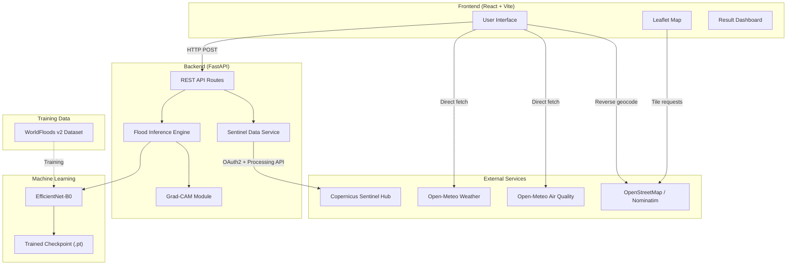
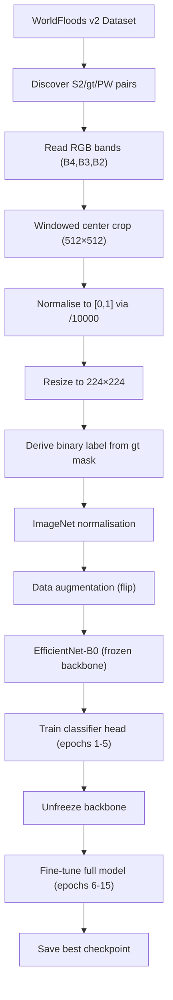
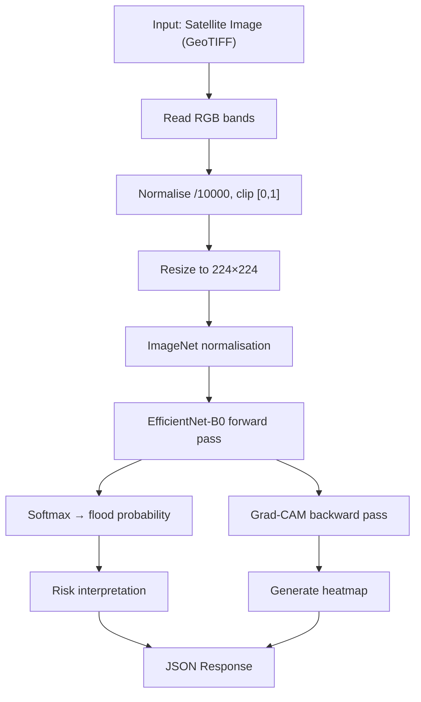
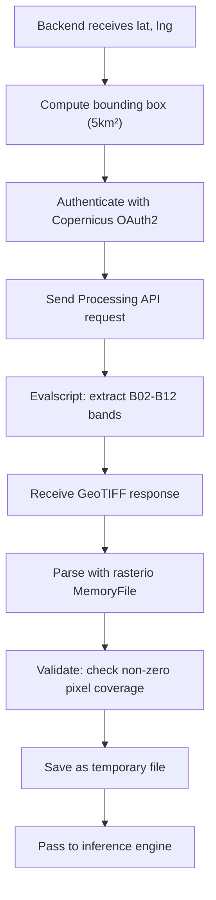
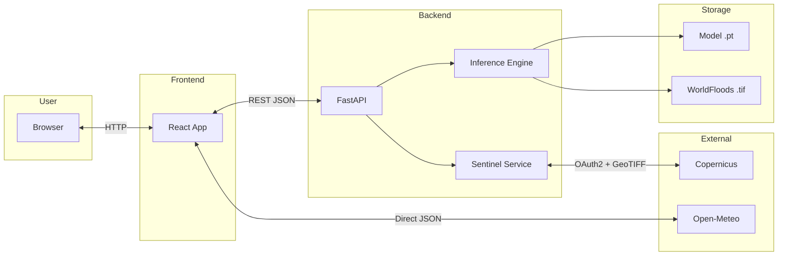
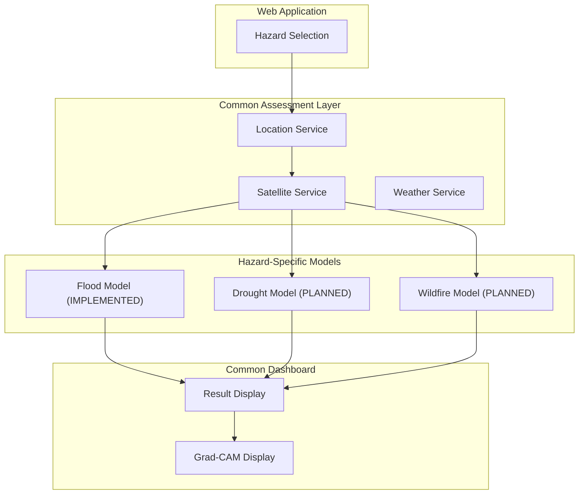

# Deep Learning-Based Early Detection and Classification of Climate-Induced Natural Disasters Using Satellite Imagery

## Final Year Project Report

**Programme:** B.Sc. Artificial Intelligence and Machine Learning

**Application Name:** Disaster Insights

---

# Preliminary Pages

---

## Cover Page

**Deep Learning-Based Early Detection and Classification of Climate-Induced Natural Disasters Using Satellite Imagery**

B.Sc. Artificial Intelligence and Machine Learning — Final Year Project Report

Application: **Disaster Insights**

---

## Certificate

`[INSERT COLLEGE CERTIFICATE PAGE]`

---

## Declaration

I hereby declare that the project entitled *"Deep Learning-Based Early Detection and Classification of Climate-Induced Natural Disasters Using Satellite Imagery"* is my original work carried out under the guidance of my project supervisor. The work has not been submitted elsewhere for any other degree or diploma.

`[INSERT STUDENT NAME, ROLL NUMBER, DATE, SIGNATURE]`

---

## Acknowledgement

I express my sincere gratitude to my project guide and the Department of Artificial Intelligence and Machine Learning for their continuous guidance and support. I also acknowledge the open-source communities behind PyTorch, EfficientNet, WorldFloods, Copernicus Data Space, Open-Meteo, React, FastAPI, Leaflet, and OpenStreetMap, without which this project would not have been possible.

`[INSERT NAMES OF GUIDE, HOD, COLLEGE]`

---

## Abstract

Climate-induced natural disasters, particularly floods, pose an escalating threat to communities worldwide. Timely and accurate assessment of flood events using satellite imagery can support disaster response and informed decision-making. This project presents **Disaster Insights**, a web-based application that employs deep learning to assess flood risk from Sentinel-2 satellite imagery.

The system uses an EfficientNet-B0 convolutional neural network, trained via transfer learning on the WorldFloods v2 dataset, to perform binary classification of satellite images into flood and non-flood categories. The trained model achieves a test accuracy of 98.1%, with a precision of 98.1%, recall of 100%, and an F1 score of 99.0% on the evaluation set. The system integrates Gradient-weighted Class Activation Mapping (Grad-CAM) to provide visual explanations of model predictions, highlighting which regions of a satellite image contributed most to the classification decision.

The application comprises a React-based frontend with a glassmorphism user interface, a FastAPI backend serving model predictions, and integration with the Copernicus Data Space Ecosystem for live Sentinel-2 imagery retrieval via the Sentinel Hub Processing API. Additional contextual data including weather conditions and air quality indices are sourced from the Open-Meteo API.

The current implementation focuses exclusively on flood assessment. The system architecture is designed to be extensible, with future modules for drought and wildfire assessment planned but not yet implemented. This report documents the complete design, implementation, evaluation, and demonstration of the flood assessment pipeline.

**Keywords:** Flood Detection, Satellite Imagery, Deep Learning, EfficientNet-B0, Transfer Learning, Grad-CAM, Sentinel-2, Remote Sensing, Climate Disaster, Web Application, Copernicus

---

## Table of Contents

- Chapter 1 — Introduction
- Chapter 2 — Background and Literature Review
- Chapter 3 — Problem Analysis, Goals and Requirements
- Chapter 4 — Proposed System and Architecture
- Chapter 5 — Dataset and Data Preparation
- Chapter 6 — Machine Learning Methodology
- Chapter 7 — System Implementation
- Chapter 8 — User Interface and Application Workflow
- Chapter 9 — Results and Evaluation
- Chapter 10 — Testing
- Chapter 11 — Limitations and Future Work
- Chapter 12 — Conclusion
- References
- Appendices

`[NOTE: Update page numbers after final formatting in Word/LaTeX]`

---

## List of Figures

| Figure | Title | Chapter |
|--------|-------|---------|
| 4.1 | Overall System Architecture | 4 |
| 4.2 | End-to-End Data Flow | 4 |
| 4.3 | Flood Training Pipeline | 4 |
| 4.4 | Flood Inference Pipeline | 4 |
| 4.5 | Frontend–Backend Communication | 4 |
| 4.6 | Location Selection Workflow | 4 |
| 4.7 | Satellite Retrieval Workflow | 4 |
| 4.8 | Grad-CAM Workflow | 4 |
| 4.9 | Future Multi-Hazard Architecture | 4 |
| 5.1 | WorldFloods Dataset Structure | 5 |
| 5.2 | Image–Mask Relationship | 5 |
| 5.3 | Data Preprocessing Pipeline | 5 |
| 6.1 | EfficientNet-B0 Architecture | 6 |
| 6.2 | Transfer Learning Strategy | 6 |
| 6.3 | Training Loss Curve | 6 |
| 6.4 | Validation Accuracy Curve | 6 |
| 8.1 | Welcome Screen | 8 |
| 8.2 | Location Selection with Map Modal | 8 |
| 8.3 | Flood Assessment Result Dashboard | 8 |
| 8.4 | Grad-CAM Heatmap Display | 8 |
| 8.5 | Weather and AQI Tab | 8 |
| 9.1 | Training Curves | 9 |
| 9.2 | Confusion Matrix | 9 |
| 9.3 | Sample Grad-CAM Outputs | 9 |

`[INSERT ACTUAL FIGURE PAGE NUMBERS AFTER FORMATTING]`

---

## List of Tables

| Table | Title | Chapter |
|-------|-------|---------|
| 2.1 | Literature Review Summary | 2 |
| 3.1 | Hardware Requirements | 3 |
| 3.2 | Software Requirements | 3 |
| 5.1 | WorldFloods v2 Dataset Summary | 5 |
| 5.2 | Dataset Split Distribution | 5 |
| 5.3 | Sentinel-2 Band Information | 5 |
| 6.1 | Model Configuration | 6 |
| 6.2 | Training Hyperparameters | 6 |
| 7.1 | Technology Stack | 7 |
| 7.2 | API Endpoints | 7 |
| 7.3 | Actual vs Planned Feature Matrix | 7 |
| 9.1 | Training Log Per Epoch | 9 |
| 9.2 | Final Evaluation Metrics | 9 |
| 9.3 | Confusion Matrix Values | 9 |
| 10.1 | Test Case Matrix | 10 |

`[INSERT ACTUAL TABLE PAGE NUMBERS AFTER FORMATTING]`

---

## List of Abbreviations

| Abbreviation | Full Form |
|-------------|-----------|
| AI | Artificial Intelligence |
| AQI | Air Quality Index |
| API | Application Programming Interface |
| B02, B03, B04 | Sentinel-2 Spectral Bands (Blue, Green, Red) |
| CDSE | Copernicus Data Space Ecosystem |
| CNN | Convolutional Neural Network |
| CORS | Cross-Origin Resource Sharing |
| DL | Deep Learning |
| DN | Digital Number |
| GeoTIFF | Georeferenced Tagged Image File Format |
| GPU | Graphics Processing Unit |
| Grad-CAM | Gradient-weighted Class Activation Mapping |
| HTTP | Hypertext Transfer Protocol |
| JRC | Joint Research Centre |
| ML | Machine Learning |
| NIR | Near-Infrared |
| NWP | Numerical Weather Prediction |
| REST | Representational State Transfer |
| RGB | Red, Green, Blue |
| SCL | Scene Classification Layer |
| SWIR | Short-Wave Infrared |
| TIFF | Tagged Image File Format |
| UI | User Interface |
| VRAM | Video Random Access Memory |

---

# Chapter 1 — Introduction

## 1.1 Background

Natural disasters driven by climate change have become more frequent and more severe over the past several decades. The Intergovernmental Panel on Climate Change (IPCC) has documented clear trends linking rising global temperatures to increased occurrence of extreme weather events, including floods, droughts, and wildfires (IPCC, 2021). Traditional disaster monitoring systems, which rely primarily on ground-based observations and manual reporting, often lack the spatial coverage and response speed required for effective early assessment.

Satellite remote sensing offers a transformative approach to disaster assessment. Earth observation satellites such as the European Space Agency's Sentinel-2 constellation provide systematic, repeated coverage of the Earth's surface at high spatial resolution. When combined with deep learning techniques capable of automatically interpreting satellite imagery, these data sources enable scalable, objective, and rapid assessment of disaster events.

This project develops **Disaster Insights**, a web-based application that applies deep learning to Sentinel-2 satellite imagery for the assessment of climate-induced natural disasters. The current implementation focuses on flood assessment, with the system architecture designed to accommodate future extensions for drought and wildfire.

## 1.2 Climate-Induced Natural Disasters

Climate-induced natural disasters are events whose frequency, intensity, or geographic scope is influenced by changes in the Earth's climate system. The three primary categories relevant to this project are:

**Floods** are the most common natural disaster worldwide, affecting more people annually than any other hazard type. Climate change amplifies flood risk through increased precipitation intensity, accelerated glacial melt, and rising sea levels.

**Droughts** involve prolonged periods of abnormally low precipitation, leading to water scarcity, crop failure, and ecosystem degradation. Climate change alters precipitation patterns and increases evapotranspiration rates, intensifying drought conditions.

**Wildfires** are uncontrolled fires that consume vegetation and can threaten human settlements. Rising temperatures, reduced humidity, and altered wind patterns create conditions conducive to more frequent and severe wildfire events.

While the broader project vision encompasses all three disaster types, the current implementation addresses flood assessment exclusively. Drought and wildfire modules are described as future extensions in Chapter 11.

## 1.3 Floods and Their Impact

Floods represent the most prevalent natural disaster category globally. According to the Centre for Research on the Epidemiology of Disasters (CRED), floods accounted for approximately 44% of all natural disaster events between 2000 and 2019, affecting over 1.65 billion people worldwide. The economic losses from flood events are substantial, with annual global flood damages estimated in the hundreds of billions of US dollars.

Flood events can be categorised by their causal mechanism:

- **Fluvial (riverine) floods** occur when rivers or streams exceed their channel capacity due to prolonged or intense rainfall.
- **Pluvial (surface water) floods** result from intense rainfall overwhelming urban drainage systems.
- **Coastal floods** are caused by storm surges, tidal events, or sea-level rise.
- **Flash floods** develop rapidly, often within hours, due to intense rainfall over a localised area.

Satellite imagery is particularly valuable for flood assessment because floodwater produces distinctive spectral signatures in optical imagery. Water absorbs near-infrared radiation while reflecting visible light, creating a contrast that can be detected algorithmically. Sentinel-2 imagery, with its 10-metre spatial resolution and 5-day revisit frequency, provides a suitable data source for detecting and mapping flood extent.

## 1.4 Satellite Imagery and Remote Sensing

Remote sensing is the acquisition of information about the Earth's surface from a distance, typically using sensors mounted on satellites or aircraft. For disaster assessment, optical satellite imagery is widely used because it captures the visual characteristics of terrain, vegetation, water bodies, and infrastructure.

**Sentinel-2** is a twin-satellite constellation operated by the European Space Agency (ESA) as part of the Copernicus Programme. Each satellite carries a Multispectral Instrument (MSI) that captures imagery in 13 spectral bands spanning visible, near-infrared, and shortwave infrared wavelengths. The spatial resolution varies from 10 metres (visible and NIR bands) to 60 metres (atmospheric correction bands).

Key characteristics of Sentinel-2 relevant to this project:

- **Spatial resolution:** 10 metres for bands B02 (Blue), B03 (Green), B04 (Red), and B08 (NIR)
- **Temporal resolution:** 5-day revisit at the equator (combined A and B satellites)
- **Spectral coverage:** 13 bands from 443 nm to 2190 nm
- **Data policy:** Free and open access under Copernicus data licensing
- **Processing levels:** Level-2A products include atmospheric correction and a Scene Classification Layer (SCL)

The Copernicus Data Space Ecosystem (CDSE) provides the primary access mechanism for Sentinel-2 data in this project. The Sentinel Hub Processing API enables on-demand retrieval of processed imagery for specified geographic regions and time periods.

## 1.5 Deep Learning in Disaster Assessment

Deep learning, a subfield of machine learning based on artificial neural networks with multiple layers, has demonstrated exceptional performance in image classification, object detection, and semantic segmentation tasks. Convolutional Neural Networks (CNNs) are the predominant architecture for image analysis, as their convolutional layers are inherently designed to extract spatial features from two-dimensional data.

Transfer learning is a technique in which a model pre-trained on a large general-purpose dataset (such as ImageNet, which contains 1.2 million images across 1,000 categories) is adapted to a new, typically smaller, domain-specific dataset. This approach is particularly valuable when the target dataset is limited in size, as is common in remote sensing applications.

For flood detection, a CNN can be trained to distinguish satellite images containing floodwater from those depicting normal (non-flood) conditions. The model learns visual features such as water surface reflectance patterns, changes in vegetation appearance due to inundation, and alterations in land surface texture that indicate flooding.

## 1.6 Motivation

The motivation for this project stems from several converging factors:

1. **Increasing disaster frequency:** Climate change is driving measurable increases in the frequency and severity of natural disasters, creating an urgent need for improved assessment tools.

2. **Satellite data abundance:** The Sentinel-2 constellation generates approximately 1.6 terabytes of data per day, representing a vast and underutilised resource for disaster assessment.

3. **Deep learning maturity:** Transfer learning with modern CNN architectures has reached a level of performance and accessibility that makes satellite image classification feasible as a student project.

4. **Explainability requirement:** Explainable AI techniques such as Grad-CAM can provide visual evidence of what a model has learned, making predictions more interpretable and trustworthy.

5. **Practical demonstration value:** A web application that combines satellite imagery, deep learning, and interactive mapping provides a tangible and demonstrable project outcome.

## 1.7 Need for the Project

Existing flood monitoring systems are typically operated by governmental agencies with substantial infrastructure requirements. These systems often:

- Rely on expensive SAR (Synthetic Aperture Radar) satellite data that requires specialised processing
- Use proprietary software and closed platforms
- Provide delayed outputs due to manual interpretation steps
- Lack explainability regarding how assessments are derived

This project addresses these gaps by providing an open, explainable, and accessible flood assessment tool built on freely available satellite data and open-source deep learning frameworks. While the system does not replace official disaster warning mechanisms, it demonstrates the feasibility of AI-based flood assessment and serves as a prototype for future development.

## 1.8 Problem Statement

Develop a deep learning-based web application that can assess flood risk from Sentinel-2 satellite imagery, provide visual explanations of model predictions using Grad-CAM, and present results through an interactive user interface with geographic context.

## 1.9 Objectives

1. Train an EfficientNet-B0 model for binary flood/non-flood classification using the WorldFloods v2 dataset.
2. Implement Grad-CAM for visual explanation of model predictions.
3. Build a FastAPI backend to serve model predictions via a REST API.
4. Develop a React frontend with interactive map-based location selection.
5. Integrate Copernicus Sentinel Hub for live satellite imagery retrieval.
6. Provide contextual weather and air quality information for selected locations.
7. Design the system architecture to support future extensions for drought and wildfire assessment.

## 1.10 Scope

**In scope (current implementation):**
- Flood detection using binary image classification
- EfficientNet-B0 with transfer learning from ImageNet
- WorldFloods v2 dataset for training and evaluation
- Grad-CAM explainability
- React web frontend with Leaflet map integration
- FastAPI REST API backend
- Live Sentinel-2 imagery via Copernicus CDSE
- Weather data from Open-Meteo API
- Air quality data from Open-Meteo Air Quality API

**Out of scope (future work):**
- Drought detection and assessment
- Wildfire detection and assessment
- Pixel-level semantic segmentation
- SAR (radar) imagery processing
- Database persistence and user accounts
- Production deployment and cloud hosting
- Official disaster alert integration

## 1.11 Significance

This project demonstrates the practical application of several key concepts from the B.Sc. AI and ML curriculum:

- **Deep learning and CNNs** for image classification
- **Transfer learning** for efficient model training with limited data
- **Explainable AI** for model interpretation
- **Remote sensing** data processing
- **Full-stack development** integrating ML with web technologies
- **API design** for serving model predictions

The project also provides a foundation for future academic work on multi-hazard disaster assessment systems.

## 1.12 Project Overview

Disaster Insights is structured as a three-tier application:

1. **Machine Learning Layer:** EfficientNet-B0 trained on WorldFloods v2 for flood classification, with Grad-CAM for explainability.
2. **Backend Layer:** FastAPI server that loads the trained model, handles satellite imagery retrieval, and serves predictions as JSON.
3. **Frontend Layer:** React application with glassmorphism UI design, Leaflet map integration, and interactive flood assessment workflow.

The user workflow is: select a location → choose assessment mode (demo or live satellite) → run flood assessment → view results with risk level, confidence, satellite image, and Grad-CAM heatmap.

## 1.13 Current Implementation Scope

> **Important Note:** This is the first working version of the application, focused exclusively on flood assessment. The system is designed for climate-induced natural disasters only. Drought and wildfire assessment modules are planned as future extensions and are not currently implemented. Many updates and improvements are planned for subsequent versions.

## 1.14 Chapter Summary

This chapter introduced the project background, the problem of climate-induced natural disasters, the role of satellite imagery and deep learning in disaster assessment, and the objectives and scope of the Disaster Insights application. The following chapters provide detailed coverage of background research, system design, dataset preparation, model methodology, implementation, results, testing, limitations, and future work.

---

# Chapter 2 — Background and Literature Review

## 2.1 Remote Sensing for Disaster Assessment

Remote sensing has been used for environmental monitoring since the launch of the first Landsat satellite in 1972. The ability to observe large geographic areas systematically and repeatedly makes satellite remote sensing indispensable for disaster assessment. Modern satellite constellations provide imagery at spatial resolutions sufficient to detect flooding, drought stress in vegetation, and fire-affected areas.

Two primary sensor types are used in disaster remote sensing:

**Optical sensors** capture reflected sunlight in visible and infrared wavelengths. They provide intuitive imagery interpretable by both humans and machine learning models. Their principal limitation is susceptibility to cloud cover, which obscures the ground surface.

**Synthetic Aperture Radar (SAR) sensors** transmit and receive microwave pulses. SAR imagery is unaffected by cloud cover and can distinguish water surfaces by their specular reflection characteristics. However, SAR data requires specialised processing and is less intuitive for visual interpretation.

This project uses optical Sentinel-2 imagery. While cloud cover is a recognised limitation (discussed in Chapter 11), the free availability, high resolution, and spectral richness of Sentinel-2 data make it a practical choice for a student project.

## 2.2 Satellite-Based Flood Assessment

Satellite-based flood assessment involves detecting the presence and extent of floodwater in satellite imagery. The spectral characteristics of water differ from those of dry land, vegetation, and built-up areas, enabling algorithmic detection.

Key spectral indices used in flood mapping include:

- **Normalised Difference Water Index (NDWI):** Uses green and near-infrared bands to highlight water surfaces.
- **Modified NDWI (MNDWI):** Substitutes shortwave infrared for near-infrared, improving discrimination of urban areas.
- **Water Ratio Index (WRI):** Combines multiple bands to enhance water detection.

While index-based methods are computationally simple, they require manual threshold selection and may produce false positives in areas with similar spectral characteristics (e.g., shadows, bare soil). Deep learning approaches can learn more complex decision boundaries directly from labelled examples, potentially improving accuracy and reducing the need for manual tuning.

## 2.3 Sentinel-2

The Sentinel-2 mission comprises two identical satellites, Sentinel-2A (launched June 2015) and Sentinel-2B (launched March 2017). Together they provide global coverage with a 5-day revisit interval at the equator.

Table 2.3: Sentinel-2 Spectral Bands Used in This Project

| Band | Centre Wavelength (nm) | Resolution (m) | Purpose |
|------|----------------------|----------------|---------|
| B02 | 490 | 10 | Blue |
| B03 | 560 | 10 | Green |
| B04 | 665 | 10 | Red |
| B08 | 842 | 10 | Near-Infrared (NIR) |
| B11 | 1610 | 20 | Short-Wave Infrared 1 |
| B12 | 2190 | 20 | Short-Wave Infrared 2 |

The Level-2A processing level includes bottom-of-atmosphere reflectance values (corrected for atmospheric effects) and a Scene Classification Layer (SCL) that categorises each pixel as vegetation, bare soil, water, cloud, cloud shadow, or other surface types.

## 2.4 Optical Satellite Imagery

Optical satellite imagery records the intensity of reflected sunlight across different wavelengths. Each spectral band captures a different portion of the electromagnetic spectrum, and the combination of bands provides information about surface composition and condition.

For this project, the satellite image is represented as a multi-band raster file in GeoTIFF format. Each pixel contains reflectance values for multiple spectral bands. The model input is derived from three bands (B04 Red, B03 Green, B02 Blue) to form a true-colour RGB composite image, which is then normalised and resized for input to the CNN.

## 2.5 Image Classification

Image classification is the task of assigning a categorical label to an entire image based on its visual content. In the context of this project, the classification task is binary: each satellite image is labelled as either "flood" (class 1) or "non-flood" (class 0).

This differs from semantic segmentation, where every pixel is assigned a class label. Image-level classification is computationally simpler and produces a single prediction per image, which is appropriate for generating an overall flood risk assessment for a geographic region.

## 2.6 Convolutional Neural Networks

Convolutional Neural Networks (CNNs) are a class of deep neural networks designed for processing grid-structured data such as images. The key architectural components of a CNN are:

**Convolutional layers** apply learnable filters (kernels) to input data, extracting local spatial features such as edges, textures, and patterns. Each filter produces a feature map highlighting the presence of a specific feature across the input.

**Pooling layers** reduce the spatial dimensions of feature maps, introducing translation invariance and reducing computational requirements. Max pooling and average pooling are the most common variants.

**Fully connected layers** aggregate features from across the entire spatial extent of the input and produce the final classification output.

**Activation functions** (typically ReLU — Rectified Linear Unit) introduce non-linearity, enabling the network to learn complex decision boundaries.

CNNs are particularly effective for satellite image classification because they can learn hierarchical feature representations: low-level features such as spectral patterns in early layers, and high-level features such as flood extent patterns in deeper layers.

## 2.7 Transfer Learning

Transfer learning is the practice of taking a model trained on one task (the source task) and adapting it to a different but related task (the target task). The rationale is that features learned from a large, diverse dataset often generalise well to new domains.

In this project, the transfer learning process involves:

1. **Pre-training:** EfficientNet-B0 is pre-trained on ImageNet (1.2 million images, 1,000 classes). The model learns general visual features: edges, textures, shapes, and object parts.

2. **Feature extraction (frozen backbone):** The pre-trained convolutional layers are initially frozen (weights not updated during training). Only the final classification head is trained on the flood dataset. This allows the model to leverage ImageNet features while adapting the decision boundary to the flood/non-flood distinction.

3. **Fine-tuning (unfrozen backbone):** After the classification head converges, the later convolutional layers are unfrozen and trained with a smaller learning rate. This allows the model to adapt its feature extraction to the specific characteristics of satellite imagery.

Transfer learning is essential for this project because the WorldFloods v2 dataset contains only 424 images — far fewer than the millions typically required to train a deep CNN from scratch.

## 2.8 EfficientNet

EfficientNet is a family of CNN architectures developed by Tan and Le (2019) that systematically balances network depth, width, and input resolution using a compound scaling method. The authors demonstrated that scaling all three dimensions simultaneously produces models that are both more accurate and more efficient than prior architectures.

The compound scaling method uses a single compound coefficient φ to uniformly scale depth, width, and resolution according to fixed ratios determined through neural architecture search.

## 2.9 EfficientNet-B0

EfficientNet-B0 is the baseline model of the EfficientNet family. It was identified through a neural architecture search on ImageNet and serves as the foundation from which larger variants (B1–B7) are derived through compound scaling.

Key characteristics of EfficientNet-B0:

- **Parameters:** Approximately 5.3 million
- **Input size:** 224 × 224 pixels
- **Architecture:** 16 Mobile Inverted Bottleneck Convolution (MBConv) blocks with squeeze-and-excitation optimisation
- **ImageNet accuracy:** 77.1% top-1 (without additional tricks)
- **FLOPS:** 0.39 billion

EfficientNet-B0 was selected for this project because:
1. It achieves a strong accuracy-to-parameter ratio, making it suitable for a dataset with limited samples.
2. Its 224 × 224 input size is computationally manageable on a consumer GPU (6 GB VRAM).
3. Pre-trained weights on ImageNet are readily available through the torchvision library.
4. Its compact size allows rapid inference, supporting interactive web application use.

## 2.10 Explainable AI

Explainable AI (XAI) refers to techniques that make the behaviour and predictions of machine learning models more transparent and interpretable to humans. In disaster assessment, explainability is particularly important because:

1. Decision-makers need to understand why a model predicts flood risk to make informed responses.
2. Model developers need to verify that the model has learned meaningful features rather than spurious correlations.
3. Users require visual evidence to trust AI-generated assessments.

Several XAI techniques exist for CNNs, including saliency maps, occlusion sensitivity, LIME (Local Interpretable Model-agnostic Explanations), and Grad-CAM. This project uses Grad-CAM because it produces high-resolution, class-discriminative heatmaps without requiring modifications to the model architecture.

## 2.11 Grad-CAM

Gradient-weighted Class Activation Mapping (Grad-CAM) was introduced by Selvaraju et al. (2017). It generates visual explanations for CNN predictions by examining the gradient information flowing into the last convolutional layer.

The Grad-CAM algorithm operates as follows:

1. Perform a forward pass through the model with the input image.
2. Compute the gradient of the target class score with respect to the feature maps of the last convolutional layer.
3. Global-average-pool these gradients to obtain the neuron importance weights.
4. Compute a weighted combination of the feature maps using these weights.
5. Apply ReLU to retain only positive influences (features that contribute to the target class).
6. Resize the resulting heatmap to match the input image dimensions.
7. Overlay the heatmap on the original image using a colour scale (typically the jet colormap).

The resulting heatmap highlights regions of the input image that most strongly influenced the model's prediction. For flood detection, a well-trained model should produce heatmaps that highlight water-covered areas in flood images and non-water features in non-flood images.

It is important to note that Grad-CAM is an explanation aid, not a ground truth. It shows where the model's attention was focused but does not prove that the prediction is correct.

## 2.12 Location-Based Web Applications

Modern web applications often incorporate geographic information to provide location-specific services. Key technologies used in this project for location-based functionality include:

**Leaflet** is an open-source JavaScript library for interactive maps. It provides tile-based map rendering, marker placement, and event handling. Leaflet uses tile layers from OpenStreetMap or other providers to render map imagery.

**OpenStreetMap (OSM)** is a collaborative mapping project that provides free, editable geographic data. OSM tile servers are used as the base map layer in the application.

**Nominatim** is the OpenStreetMap geocoding service, used in this project for reverse geocoding (converting latitude/longitude coordinates to human-readable place names).

## 2.13 Existing Approaches

Several systems address satellite-based flood detection:

1. **Copernicus Emergency Management Service (EMS):** Provides on-demand flood mapping using satellite imagery, operated by trained analysts. Activation-based, not continuous or automated.

2. **Google Flood Forecasting:** Uses hydrological models and ML to predict riverine floods in selected countries. Focuses on water level prediction rather than satellite image classification.

3. **UNOSAT/UNITAR:** Provides satellite-based rapid mapping for disaster response. Relies on expert interpretation and SAR imagery.

4. **Academic research:** Numerous papers have applied CNNs to flood detection, using architectures such as U-Net for segmentation and ResNet/VGG for classification. Most focus on model accuracy without providing an integrated user-facing application.

## 2.14 Literature Review Table

Table 2.1: Literature Review Summary

| Study/System | Method | Data | Task | Limitation |
|-------------|--------|------|------|------------|
| Copernicus EMS | Manual interpretation + SAR | Sentinel-1/2 | Flood mapping | Activation-based, delayed |
| Bonafilia et al. (2020) – WorldFloods | U-Net segmentation | Sentinel-2 | Pixel-level flood mapping | Research prototype only |
| Mateo-Garcia et al. (2021) | ML4Floods framework | Sentinel-2 | Flood segmentation | Requires significant compute |
| Google Flood Forecasting | Hydrological + ML | Gauge data | Water level prediction | Limited geographic coverage |
| This project (Disaster Insights) | EfficientNet-B0 classification | WorldFloods v2 / Sentinel-2 | Image-level flood assessment | Binary classification only |

## 2.15 Research Gap

The review of existing literature reveals several gaps that this project addresses:

1. **Application gap:** Most research focuses on model development without providing a user-facing application for non-expert users.
2. **Explainability gap:** Few flood detection systems incorporate visual explanation of model predictions.
3. **Accessibility gap:** Existing systems often require SAR data processing expertise or rely on proprietary platforms.
4. **Integration gap:** Few systems combine flood assessment with contextual weather and air quality data in a single interface.

## 2.16 Relevance to the Proposed Project

This project addresses the identified gaps by combining an accessible deep learning model (EfficientNet-B0 with transfer learning), visual explainability (Grad-CAM), freely available satellite data (Sentinel-2 via Copernicus), and an integrated web application (React + FastAPI) that presents flood assessment alongside weather and air quality context.

## 2.17 Chapter Summary

This chapter reviewed the background concepts underpinning this project: remote sensing for disaster assessment, Sentinel-2 satellite imagery, convolutional neural networks, transfer learning, EfficientNet-B0, explainable AI with Grad-CAM, and location-based web technologies. The literature review identified gaps in existing approaches that this project aims to address through an integrated, explainable, and accessible flood assessment system.

---

# Chapter 3 — Problem Analysis, Goals and Requirements

## 3.1 Problem Definition

Climate-induced flood events cause widespread damage and require rapid assessment. Existing satellite-based flood monitoring systems are either inaccessible to general users, require expert interpretation, or lack transparency in their predictions. There is a need for an accessible, explainable, and demonstrable flood assessment tool that can process satellite imagery using deep learning and present results through an interactive web interface.

## 3.2 Existing System / Existing Approach

Existing approaches to satellite-based flood assessment include:

- **Manual interpretation:** Trained analysts examine satellite imagery to delineate flood extent. Accurate but slow and labour-intensive.
- **Index-based methods:** Spectral indices (NDWI, MNDWI) are computed and thresholded. Fast but require manual threshold selection and are prone to false positives.
- **Deep learning segmentation:** U-Net and similar architectures segment flood pixels. Accurate but computationally expensive and require dense pixel-level labels.

## 3.3 Limitations of Existing Approaches

1. Manual interpretation does not scale and introduces latency.
2. Index-based methods lack adaptability and produce inconsistent results across different scenes.
3. Segmentation models require large annotated datasets and substantial GPU resources for training and inference.
4. Most existing systems do not provide visual explanations of their predictions.
5. Few systems offer an integrated web-based interface accessible to non-specialist users.

## 3.4 Proposed Approach

This project proposes a classification-based approach using EfficientNet-B0 with transfer learning:

1. Convert the WorldFloods v2 segmentation dataset into image-level binary labels (flood/non-flood) based on a flood pixel ratio threshold.
2. Train an EfficientNet-B0 model using transfer learning from ImageNet.
3. Generate Grad-CAM explanations for each prediction.
4. Serve the model through a FastAPI REST API.
5. Present results through a React web application with map-based location selection.

## 3.5 Functional Requirements

| ID | Requirement | Status |
|----|------------|--------|
| FR-01 | The system shall classify satellite images as flood or non-flood | IMPLEMENTED |
| FR-02 | The system shall display flood risk level with confidence percentage | IMPLEMENTED |
| FR-03 | The system shall generate Grad-CAM heatmaps for model predictions | IMPLEMENTED |
| FR-04 | The system shall allow users to select locations on an interactive map | IMPLEMENTED |
| FR-05 | The system shall support geolocation-based location detection | IMPLEMENTED |
| FR-06 | The system shall fetch live Sentinel-2 satellite imagery | IMPLEMENTED |
| FR-07 | The system shall display current weather conditions | IMPLEMENTED |
| FR-08 | The system shall display air quality index data | IMPLEMENTED |
| FR-09 | The system shall support demo mode using archived satellite images | IMPLEMENTED |
| FR-10 | The system shall provide disclaimers stating this is not an official warning system | IMPLEMENTED |

## 3.6 Non-Functional Requirements

| ID | Requirement | Status |
|----|------------|--------|
| NFR-01 | Inference latency shall be under 5 seconds on GPU | IMPLEMENTED |
| NFR-02 | The UI shall follow glassmorphism design principles | IMPLEMENTED |
| NFR-03 | API credentials shall be stored in environment variables, not in source code | IMPLEMENTED |
| NFR-04 | The system shall display appropriate error messages for failed operations | IMPLEMENTED |
| NFR-05 | The frontend shall be responsive across screen sizes | IMPLEMENTED |

## 3.7 Hardware Requirements

Table 3.1: Hardware Requirements

| Component | Minimum | Recommended |
|-----------|---------|-------------|
| Processor | Intel Core i5 / AMD Ryzen 5 | Intel Core i7 / AMD Ryzen 7 |
| RAM | 8 GB | 16 GB |
| GPU | NVIDIA GPU with 4 GB VRAM (CUDA support) | NVIDIA GPU with 6+ GB VRAM |
| Storage | 10 GB free space (model + dataset) | 20 GB free space |
| Internet | Required for satellite/weather APIs | Broadband recommended |

Note: The system can run on CPU only, but inference will be slower (approximately 2-5 seconds per image on CPU vs under 1 second on GPU).

## 3.8 Software Requirements

Table 3.2: Software Requirements

| Software | Version | Purpose |
|----------|---------|---------|
| Python | 3.12+ | Backend, ML training and inference |
| Node.js | 18+ | Frontend build and development server |
| PyTorch | 2.x | Deep learning framework |
| torchvision | 0.x | Pre-trained models and transforms |
| FastAPI | 0.x | REST API framework |
| Uvicorn | 0.x | ASGI server |
| React | 19.x | Frontend framework |
| Vite | 8.x | Frontend build tool |
| rasterio | 1.x | GeoTIFF reading |
| numpy | 1.x | Array processing |
| Pillow | 10.x | Image processing |
| matplotlib | 3.x | Grad-CAM visualisation |
| requests | 2.x | HTTP client for Copernicus API |
| python-dotenv | 1.x | Environment variable loading |
| axios | 1.x | Frontend HTTP client |
| Leaflet | 1.9.x | Interactive maps |
| react-leaflet | 5.x | React bindings for Leaflet |

## 3.9 User Requirements

The primary users of this application are:
1. Students and researchers studying satellite-based disaster assessment.
2. Project examiners evaluating the technical demonstration.
3. General users interested in understanding flood risk for specific locations.

Users should be able to select a geographic location and receive an AI-generated flood risk assessment with visual explanation, without requiring any knowledge of remote sensing or machine learning.

## 3.10 ML Requirements

1. The model shall be trained on a publicly available, peer-reviewed dataset.
2. The model shall use transfer learning to compensate for limited training data.
3. The training process shall be reproducible from documented hyperparameters.
4. Evaluation metrics shall include accuracy, precision, recall, and F1 score.
5. The model shall include Grad-CAM explainability.

## 3.11 API Requirements

1. The backend shall expose RESTful API endpoints with JSON request/response formats.
2. The API shall validate input coordinates (latitude: -90 to 90, longitude: -180 to 180).
3. The API shall support both demo and live assessment modes.
4. External API dependencies (Copernicus, Open-Meteo) shall be accessed from the backend, not the frontend (except Open-Meteo, which is accessed directly from the frontend as it requires no authentication).

## 3.12 Security Requirements

1. Copernicus API credentials shall be stored in a `.env` file excluded from version control.
2. The `.env.example` file shall document required environment variables without exposing actual values.
3. CORS shall restrict API access to known frontend origins.
4. Input validation shall prevent injection through API request parameters.

## 3.13 Constraints

1. The WorldFloods v2 dataset is imbalanced, with approximately 96% flood images and 4% non-flood images.
2. Sentinel-2 optical imagery is affected by cloud cover, limiting effectiveness in persistently cloudy regions.
3. The 5-day Sentinel-2 revisit interval means the available imagery may not capture the current moment.
4. The model performs image-level classification, not pixel-level segmentation, so it cannot delineate exact flood boundaries.
5. The application runs locally and is not deployed to a production server.

## 3.14 Assumptions

1. The user has a modern web browser with JavaScript enabled.
2. Internet connectivity is available for satellite imagery retrieval and weather data.
3. For live satellite mode, the user has registered for Copernicus Data Space Ecosystem credentials.
4. The trained model checkpoint file (`best_flood_model.pt`) is present in the expected directory.

---

# Chapter 4 — Proposed System and Architecture

## 4.1 System Overview

Disaster Insights is a three-tier web application consisting of a machine learning layer, a backend API layer, and a frontend presentation layer. The system processes geographic coordinates from the user, retrieves satellite imagery, runs a trained deep learning model, and presents the flood assessment results through an interactive dashboard.

## 4.2 High-Level Architecture

Figure 4.1: Overall System Architecture



*Caption: Figure 4.1 — The overall system architecture of Disaster Insights, showing the three-tier structure: React frontend, FastAPI backend, and ML pipeline, along with external service integrations.*

## 4.3 User Workflow

The user workflow follows these steps:

1. User opens the application in a web browser.
2. User selects a geographic location via geolocation, map click, or coordinate entry.
3. The application reverse-geocodes the coordinates to display a human-readable place name.
4. User selects the assessment mode (live satellite or demo).
5. User clicks "Run Flood Assessment."
6. The frontend sends coordinates and mode to the backend API.
7. In live mode, the backend fetches Sentinel-2 imagery from Copernicus.
8. The backend runs the EfficientNet-B0 model on the satellite image.
9. The backend generates a Grad-CAM heatmap.
10. The backend returns the prediction, risk interpretation, satellite image, and heatmap to the frontend.
11. The frontend displays the results in the dashboard.

## 4.4 Location-to-Assessment Workflow

Figure 4.6: Location Selection Workflow


*Caption: Figure 4.6 — Location selection workflow showing the two input methods (geolocation and map selection) and the reverse geocoding step.*

## 4.5 Training Pipeline

Figure 4.3: Flood Training Pipeline



*Caption: Figure 4.3 — The complete training pipeline from raw WorldFloods data to saved model checkpoint.*

## 4.6 Inference Pipeline

Figure 4.4: Flood Inference Pipeline



*Caption: Figure 4.4 — The inference pipeline showing the steps from input image to final prediction with Grad-CAM explanation.*

## 4.7 Frontend Architecture

The frontend is a single-page React application bundled with Vite. It consists of:

- **App.jsx:** The main component containing all application state and UI logic.
- **index.css:** The complete styling using glassmorphism design principles.
- **Leaflet integration:** Interactive map for location selection within a modal window.
- **Axios:** HTTP client for communicating with the FastAPI backend and external APIs.

The frontend directly accesses Open-Meteo APIs for weather and air quality data (these require no authentication), while flood assessment requests are routed through the backend.

## 4.8 Backend Architecture

The FastAPI backend provides the following structure:

- **main.py:** Application entry point, CORS configuration, router registration.
- **api/flood_routes.py:** API endpoints for flood assessment, model status, and satellite status.
- **services/sentinel_service.py:** Copernicus CDSE integration for live satellite imagery.

The backend uses a singleton pattern for the inference engine and sentinel service to avoid reloading the model or re-authenticating on every request.

## 4.9 ML Architecture

The ML layer comprises:

- **models/flood_classifier.py:** EfficientNet-B0 architecture definition with classifier head modification.
- **datasets/flood_dataset.py:** WorldFloods data loader with label derivation logic.
- **training/train_flood.py:** Complete training script with configuration, data loading, training loop, and checkpointing.
- **inference/flood_inference.py:** Inference engine with image loading, preprocessing, prediction, and risk interpretation.
- **explainability/gradcam.py:** Grad-CAM implementation with hook-based gradient capture.

## 4.10 Satellite Integration Architecture

Figure 4.7: Satellite Retrieval Workflow



*Caption: Figure 4.7 — Satellite imagery retrieval workflow using the Copernicus Sentinel Hub Processing API.*

## 4.11 External API Integration

| API | Provider | Authentication | Used For |
|-----|----------|---------------|----------|
| Sentinel Hub Processing API | Copernicus CDSE | OAuth2 (client credentials) | Live Sentinel-2 imagery |
| Sentinel Hub Catalogue API | Copernicus CDSE | OAuth2 | Check data availability |
| Open-Meteo Forecast | Open-Meteo | None (open) | Weather data (ECMWF/ICON/GFS) |
| Open-Meteo Air Quality | Open-Meteo | None (open) | AQI data (PM2.5, PM10, O₃, NO₂, SO₂, CO) |
| Nominatim | OpenStreetMap | None (open) | Reverse geocoding |

## 4.12 Error Handling Architecture

The system implements error handling at multiple levels:

1. **Frontend:** Try-catch blocks around API calls with user-friendly error messages.
2. **Backend:** HTTP exception handlers returning appropriate status codes (404, 422, 500, 503).
3. **ML:** Corrupted file handling in the dataset loader (returns alternative sample).
4. **Satellite:** Coverage validation (rejects images with insufficient clear pixels).
5. **External APIs:** Timeout handling and fallback behaviour.

## 4.13 Data Flow

Figure 4.2: End-to-End Data Flow



*Caption: Figure 4.2 — End-to-end data flow between user, frontend, backend, model, and external services.*

## 4.14 Security Flow

- Copernicus credentials are stored in `backend/.env` (excluded from Git via `.gitignore`).
- `.env.example` documents the required variables without exposing values.
- CORS middleware restricts backend access to `localhost:3000` and `localhost:5173`.
- Pydantic models validate all API input parameters.

## 4.15 Current vs Future Architecture

Figure 4.9: Future Multi-Hazard Architecture

**FUTURE ARCHITECTURE — NOT CURRENTLY IMPLEMENTED**



*Caption: Figure 4.9 — Future multi-hazard architecture showing how additional disaster modules could be added without rewriting common infrastructure. Only the Flood Model is currently implemented.*

---

# Chapter 5 — Dataset and Data Preparation

## 5.1 Dataset Introduction

The training and evaluation of the flood classification model requires a dataset of satellite images with associated ground truth labels indicating the presence or absence of flooding. This project uses the WorldFloods v2 dataset, a publicly available collection of Sentinel-2 satellite imagery from documented flood events.

## 5.2 WorldFloods v2

WorldFloods v2 is a dataset created for the development and benchmarking of flood mapping algorithms. It was developed as part of the ML4Floods framework (Mateo-Garcia et al., 2021) and provides Sentinel-2 imagery paired with manually-delineated flood extent masks.

The dataset covers flood events from multiple geographic regions and time periods, providing diversity in terrain types, flood characteristics, and atmospheric conditions.

## 5.3 Dataset Source

The WorldFloods v2 dataset is publicly available through the ML4Floods project. The data was accessed and downloaded for use in this project under its open licensing terms.

## 5.4 Dataset Licence

The WorldFloods v2 dataset is released under academic open-access terms. Sentinel-2 imagery is provided by ESA/Copernicus under the Copernicus data licensing terms, which permit free and open use for research and commercial purposes.

## 5.5 Dataset Structure

The dataset is organised into three splits: train, val, and test. Each split contains three subdirectories:

```
worldfloods_v2/
├── train/
│   ├── S2/                   # Sentinel-2 imagery (multi-band GeoTIFF)
│   ├── gt/                   # Ground truth flood masks
│   └── PERMANENTWATERJRC/    # Permanent water body masks (JRC)
├── val/
│   ├── S2/
│   ├── gt/
│   └── PERMANENTWATERJRC/
└── test/
    ├── S2/
    ├── gt/
    └── PERMANENTWATERJRC/
```

## 5.6 Sentinel-2 Data

Each S2 file is a multi-band GeoTIFF containing 15 spectral bands. The files use the `int16` data type with reflectance values scaled by a factor of 10,000 (i.e., a reflectance of 0.5 is stored as 5000).

Key verified characteristics from implementation evidence:
- **Band count:** 15 bands per image
- **Data type:** int16
- **Value range:** 0 to approximately 13,000 DN
- **Spatial extent:** Varies per event (typical: 4000+ × 4000+ pixels at 10m resolution)

## 5.7 Image Files

The S2 image files are named after the Copernicus Emergency Management Service (EMS) activation event that each image represents. For example: `EMSR264_08VATOMANDRY_DEL_v2.tif` corresponds to a flood event in Vatomandry, documented under EMS activation EMSR264.

## 5.8 Flood Masks

Ground truth masks (`gt/`) contain pixel-level flood annotations with the following values:
- **0:** Land / dry area
- **1:** Flood water
- **2:** Cloud / no data

## 5.9 Metadata

Permanent water masks (`PERMANENTWATERJRC/`) from the Joint Research Centre provide information about permanent water bodies:
- **0:** Unknown / invalid
- **1:** Not water
- **2:** Seasonal water
- **3:** Permanent water

The permanent water masks are used during label derivation to distinguish flood water (temporary inundation) from permanent water bodies (lakes, rivers), preventing mislabelling of permanent water as flood.

## 5.10 Training/Validation/Test Organisation

The dataset is pre-split into train, validation, and test sets. Each split contains paired S2 images and ground truth masks with matching filenames.

## 5.11 Dataset Selection

WorldFloods v2 was selected for this project because:
1. It uses Sentinel-2 imagery, matching the live satellite data source.
2. It provides pixel-level ground truth masks, enabling principled label derivation.
3. It covers diverse geographic regions and flood events.
4. It is publicly available and well-documented.
5. Its size (approximately 424 images) is manageable for a student project while providing sufficient diversity.

## 5.12 Dataset Acquisition

The dataset was downloaded from the ML4Floods data repository and stored locally in the project's `data/raw/flood/worldfloods_v2/` directory.

## 5.13 Dataset Storage

The complete dataset occupies approximately 8 GB of disk space. Individual S2 GeoTIFF files range from several megabytes to over 1 GB, depending on the spatial extent of the flood event.

## 5.14 Dataset Inspection

Dataset inspection was performed to verify:
- File integrity (all paired S2/gt files readable)
- Band structure (15 bands confirmed)
- Value ranges (verified DN range 0–13,000+)
- Mask value encoding (confirmed 0=land, 1=flood, 2=cloud)
- Permanent water encoding (confirmed 0=unknown, 1=not water, 2=seasonal, 3=permanent)

## 5.15 Data Quality

The WorldFloods v2 dataset has inherent quality considerations:
- Some images contain substantial cloud cover (reflected in the gt mask as value 2).
- Flood extent varies significantly across events, from localised inundation to large-area flooding.
- Permanent water masks are not available for all images.

## 5.16 Corrupted Data Handling

The dataset loader includes error handling for corrupted or unreadable TIFF files. If a file cannot be read, the loader returns the next valid sample in the dataset, logging a warning message. This prevents training from failing due to isolated file corruption.

## 5.17 Duplicate Detection

No explicit duplicate detection is performed. The dataset is assumed to contain unique images per split, as provided by the WorldFloods authors.

## 5.18 Data Leakage Considerations

The pre-defined train/val/test splits from the WorldFloods authors are used without modification. This prevents data leakage, as images from the same flood event are kept within the same split.

## 5.19 Mask Interpretation

The ground truth masks encode pixel-level flood annotations. The label derivation process converts these pixel-level masks into image-level binary labels suitable for classification.

## 5.20 Label Generation

The label derivation rule implemented in `flood_dataset.py`:

1. Identify valid pixels: those labelled as land (0) or flood (1) in the ground truth mask. Cloud pixels (2) are excluded.
2. Identify flood pixels: those labelled as flood (1) in the ground truth mask.
3. Optionally exclude permanent water: if a permanent water mask is available, pixels classified as permanent water (value 3) are excluded from the flood count.
4. Calculate the flood ratio: `flood_ratio = flood_pixel_count / total_valid_pixels`.
5. Apply the threshold: if `flood_ratio > 0.05` (5%), the image is labelled as **flood** (1); otherwise, **non-flood** (0).

The 5% threshold was chosen to avoid labelling images with only negligible or incidental water presence as flood events, while still capturing images with moderate flood extent.

## 5.21 Image Representation

Each image is represented as a 3-channel (RGB) array extracted from the Sentinel-2 multi-band GeoTIFF. The RGB channels correspond to:
- Band index 3 (0-indexed) → Sentinel-2 B4 (Red, 665 nm)
- Band index 2 (0-indexed) → Sentinel-2 B3 (Green, 560 nm)
- Band index 1 (0-indexed) → Sentinel-2 B2 (Blue, 490 nm)

## 5.22 Preprocessing

The preprocessing pipeline applies the following transformations:

1. **Windowed reading:** A 512 × 512 pixel centre crop is read from each GeoTIFF to avoid loading full-resolution files (which can exceed 1 GB). This is implemented using rasterio's windowed read functionality.

2. **Value clipping:** Negative values (representing no-data regions) are replaced with 0.

3. **Normalisation to [0, 1]:** Raw reflectance values (range 0–10,000) are divided by 10,000 and clipped to [0, 1].

4. **Resizing:** The 512 × 512 crop is resized to 224 × 224 pixels using bilinear interpolation, matching the EfficientNet-B0 input requirement.

5. **ImageNet normalisation:** Channel-wise mean subtraction and standard deviation division using ImageNet statistics (mean=[0.485, 0.456, 0.406], std=[0.229, 0.224, 0.225]).

## 5.23 Resizing

Resizing from the windowed crop (512 × 512) to the model input (224 × 224) is performed using PIL's `Image.resize()` with bilinear interpolation. This reduces the spatial resolution by approximately 2.3×, which is acceptable for image-level classification where exact spatial detail is less critical than overall scene content.

## 5.24 Normalisation

Two normalisation stages are applied:

1. **Reflectance normalisation:** Division by 10,000 converts Sentinel-2 DN values to the 0–1 range. This matches the standard reflectance range and ensures consistent input magnitude.

2. **ImageNet normalisation:** The channel-wise mean and standard deviation from the ImageNet dataset are applied. This is necessary because the EfficientNet-B0 backbone was pre-trained on ImageNet-normalised data. Using the same normalisation ensures that the pre-trained features remain meaningful.

## 5.25 Augmentation

Data augmentation is applied only during training to increase effective dataset size and improve generalisation:

- **Random horizontal flip** (50% probability)
- **Random vertical flip** (50% probability)

These geometric augmentations are appropriate for satellite imagery because the physical interpretation of a scene does not change under reflection. More aggressive augmentations (rotation, colour jitter) were not applied to preserve the spectral characteristics critical for flood detection.

## 5.26 Dataset Split

Table 5.2: Dataset Split Distribution

| Split | Total Images | Flood | Non-Flood | Flood % |
|-------|-------------|-------|-----------|---------|
| Train | ~296 | ~284 | ~12 | ~96% |
| Val | ~54 | ~52 | ~2 | ~96% |
| Test | ~74 | ~71 | ~3 | ~96% |

Note: The exact counts may vary slightly depending on the flood_threshold setting and permanent water mask availability. The class imbalance (~96% flood) is addressed through weighted loss during training.

## 5.27 Final Model Input

The final tensor passed to the model has the following characteristics:
- **Shape:** (batch_size, 3, 224, 224) — 3 channels (RGB), 224 × 224 pixels
- **Data type:** float32
- **Value range:** Approximately [-2.1, 2.6] after ImageNet normalisation
- **Label:** Integer 0 (non-flood) or 1 (flood)

## 5.28 Dataset Limitations

1. **Class imbalance:** Approximately 96% of images are labelled as flood, resulting in a highly imbalanced dataset. This is addressed during training through weighted cross-entropy loss.
2. **Geographic bias:** The dataset covers specific flood events and may not represent all geographic and climatic conditions.
3. **Temporal limitation:** All images are from past flood events; the model has not been validated on contemporary events.
4. **Resolution reduction:** The windowed crop and resize process discards fine spatial detail that might be relevant for borderline cases.

## 5.29 Chapter Summary

This chapter described the WorldFloods v2 dataset used for training and evaluating the flood classification model. The dataset provides Sentinel-2 satellite imagery paired with pixel-level flood annotations, which are converted to image-level binary labels using a threshold-based derivation rule. The preprocessing pipeline includes windowed reading, reflectance normalisation, resizing, ImageNet normalisation, and geometric augmentation.

---

# Chapter 6 — Machine Learning Methodology

## 6.1 Machine Learning Problem

The flood detection task is formulated as a binary image classification problem:

- **Input:** A 3-channel (RGB) satellite image of size 224 × 224 pixels, derived from Sentinel-2 bands B4 (Red), B3 (Green), and B2 (Blue).
- **Output:** A probability distribution over two classes — non-flood (class 0) and flood (class 1).
- **Prediction:** The class with the higher probability is selected as the predicted label.

## 6.2 Flood Detection Objective

The model's objective is to determine whether a given satellite image contains evidence of flooding. The probability of the flood class is interpreted as a flood risk indicator:

| Probability Range | Risk Level | Label |
|-------------------|-----------|-------|
| 0.0 – 0.2 | Low | Low Risk |
| 0.2 – 0.5 | Moderate | Moderate Risk |
| 0.5 – 0.8 | High | High Risk |
| 0.8 – 1.0 | Very High | Very High Risk |

These thresholds are application-level interpretations, not official risk categories.

## 6.3 Image Classification Approach

The project uses an image-level classification approach rather than pixel-level segmentation. This choice was made because:

1. Image classification produces a single flood probability per image, which maps directly to a risk level for a geographic area.
2. It requires simpler model architecture and is less computationally demanding.
3. The WorldFloods dataset, while originally designed for segmentation, can be adapted to classification through the label derivation process described in Chapter 5.

## 6.4 Why a CNN

CNNs are selected for this task because:
1. They are specifically designed for image data, exploiting spatial locality through convolutional operations.
2. They can learn hierarchical features automatically, eliminating the need for manual feature engineering.
3. They have demonstrated strong performance across a wide range of image classification benchmarks.
4. Pre-trained CNN models are available through torchvision, enabling transfer learning.

## 6.5 Transfer Learning

Transfer learning is employed because the WorldFloods v2 dataset (approximately 424 images) is too small to train a deep CNN from scratch without severe overfitting. By starting with a model pre-trained on ImageNet (1.2 million images), the model leverages general visual features (edges, textures, colour patterns) learned from natural images.

The transfer learning strategy uses two phases:

**Phase 1 — Frozen backbone (epochs 1–5):** All convolutional layers are frozen. Only the classification head is trained. This prevents the pre-trained features from being destroyed by random gradients from the untrained head.

**Phase 2 — Fine-tuning (epochs 6–15):** The later convolutional layers (from block 5 onwards) are unfrozen and trained with the full learning rate. This allows the model to adapt its feature extraction to the specific characteristics of satellite imagery (spectral patterns, water texture, vegetation changes).

## 6.6 EfficientNet-B0

EfficientNet-B0 is selected as the backbone architecture. The model implementation in `flood_classifier.py` performs the following modifications:

1. Loads EfficientNet-B0 with ImageNet pre-trained weights from `torchvision.models`.
2. Replaces the original classifier head (1,000 classes) with a new head for 2 classes.
3. The new head consists of `Dropout(p=0.2)` followed by `Linear(1280, 2)`.

## 6.7 EfficientNet-B0 Architecture

The EfficientNet-B0 architecture consists of:

- **Stem:** Initial convolution layer (3 → 32 channels)
- **Blocks 0–7:** 16 MBConv (Mobile Inverted Bottleneck Convolution) blocks with squeeze-and-excitation optimisation
- **Head:** Convolutional layer (320 → 1280 channels) + average pooling
- **Classifier:** Dropout + Linear (1280 → num_classes)

Total parameters: approximately 5.3 million.

## 6.8 Model Input

- **Shape:** (batch_size, 3, 224, 224)
- **Channels:** RGB (Red, Green, Blue) derived from Sentinel-2 bands B4, B3, B2
- **Normalisation:** ImageNet statistics (mean=[0.485, 0.456, 0.406], std=[0.229, 0.224, 0.225])

## 6.9 Output Layer

The output layer produces a 2-element vector (logits) for each input image. Softmax is applied to convert logits to probabilities:
- `output[0]`: non-flood probability
- `output[1]`: flood probability

## 6.10 Loss Function

**CrossEntropyLoss with class weights.**

Due to the severe class imbalance (approximately 96% flood, 4% non-flood), the loss function applies inverse-frequency class weights to give greater importance to the minority (non-flood) class during training.

Verified class weights from evaluation report:
- Non-flood weight: **9.21**
- Flood weight: **0.53**

This weighting ensures that a single misclassified non-flood sample contributes more to the loss than a misclassified flood sample, encouraging the model to learn the minority class boundary.

## 6.11 Optimizer

**AdamW** (Adam with decoupled weight decay regularisation).

AdamW was selected for its adaptive learning rate per parameter, which is beneficial when different parts of the model (frozen backbone vs. trainable head) have different gradient magnitudes.

## 6.12 Learning Rate

Starting learning rate: **0.001**

The learning rate scheduler is `ReduceLROnPlateau`, which reduces the learning rate by a factor when the validation loss stops improving. This enables the model to converge more precisely in later epochs.

## 6.13 Batch Size

**Batch size: 8**

This conservative batch size was chosen to fit within 6 GB of GPU VRAM when training with full backpropagation through the EfficientNet-B0 backbone.

## 6.14 Training Procedure

Table 6.2: Training Hyperparameters

| Parameter | Value |
|-----------|-------|
| Architecture | EfficientNet-B0 |
| Pre-trained weights | ImageNet1K_V1 |
| Input size | 224 × 224 |
| Batch size | 8 |
| Number of epochs | 15 (actual training run) |
| Optimizer | AdamW |
| Initial learning rate | 0.001 |
| LR scheduler | ReduceLROnPlateau |
| Loss function | CrossEntropyLoss (weighted) |
| Frozen backbone epochs | 5 |
| Fine-tune from layer | 5 (EfficientNet blocks 5–7) |
| Data augmentation | Random H-flip, Random V-flip |
| Dropout | 0.2 (classifier head) |
| Device | CUDA (GPU) |
| Number of workers | 2 |

## 6.15 Validation Procedure

After each training epoch, the model is evaluated on the validation set with:
- Loss computed (same criterion, without weight update)
- Accuracy computed (correct predictions / total samples)
- Model set to `eval()` mode (disables dropout)
- No gradient computation (wrapped in `torch.no_grad()`)

The checkpoint with the best validation accuracy is saved as `best_flood_model.pt`.

## 6.16 Checkpointing

Model checkpoints are saved containing:
- `model_state_dict`: Model weights
- `optimizer_state_dict`: Optimizer state
- `epoch`: Training epoch number
- `val_accuracy`: Validation accuracy at save time
- `timestamp`: ISO timestamp

Two checkpoints are maintained:
- `best_flood_model.pt`: Checkpoint with the highest validation accuracy
- `final_flood_model.pt`: Checkpoint from the last training epoch

## 6.17 Evaluation Metrics

The model is evaluated using the following metrics:

## 6.18 Accuracy

Accuracy = (TP + TN) / (TP + TN + FP + FN)

The proportion of all predictions that are correct. While simple, accuracy can be misleading for imbalanced datasets.

## 6.19 Precision

Precision = TP / (TP + FP)

The proportion of predicted flood images that are actually flood images. High precision indicates few false alarms.

## 6.20 Recall

Recall = TP / (TP + FN)

The proportion of actual flood images that are correctly identified. High recall indicates few missed flood events. For disaster assessment, recall is particularly important because missing a flood event has more severe consequences than a false alarm.

## 6.21 F1 Score

F1 = 2 × (Precision × Recall) / (Precision + Recall)

The harmonic mean of precision and recall, providing a balanced measure.

## 6.22 Confusion Matrix

The confusion matrix tabulates the four possible prediction outcomes:
- **True Positive (TP):** Correctly predicted as flood
- **True Negative (TN):** Correctly predicted as non-flood
- **False Positive (FP):** Incorrectly predicted as flood (false alarm)
- **False Negative (FN):** Incorrectly predicted as non-flood (missed flood)

## 6.23 Model Inference

During inference:
1. The model is loaded from the `best_flood_model.pt` checkpoint.
2. The model is set to evaluation mode (`model.eval()`).
3. Input images undergo the same preprocessing pipeline as training (normalisation, resize).
4. Forward pass produces logits, which are converted to probabilities via softmax.
5. The flood probability (index 1) is used for risk interpretation.
6. Grad-CAM is generated by re-running a forward-backward pass with gradient tracking.

## 6.24 Model Limitations

1. The model performs binary classification, not segmentation — it cannot delineate flood boundaries.
2. The model was trained on optical imagery and is affected by cloud cover.
3. The class imbalance in the training data may bias the model toward predicting flood.
4. The model has been evaluated on the WorldFloods test set but not independently validated on arbitrary real-world locations.
5. The model does not incorporate temporal information or change detection.

## 6.25 Chapter Summary

This chapter described the machine learning methodology: binary classification with EfficientNet-B0 using transfer learning, weighted cross-entropy loss for imbalanced classes, two-phase training (frozen backbone then fine-tuning), and evaluation using accuracy, precision, recall, F1 score, and confusion matrix metrics.

---

# Chapter 7 — System Implementation

## 7.1 Development Environment

- **Operating System:** Windows 11
- **IDE:** VS Code / Antigravity IDE
- **Python:** 3.12 (virtual environment)
- **Node.js:** 18+ with npm
- **GPU:** NVIDIA GPU with CUDA support (6 GB VRAM)
- **Version Control:** Git

## 7.2 Project Folder Structure

```
final year DL project/
├── backend/                        # FastAPI backend server
│   ├── app/
│   │   ├── __init__.py
│   │   ├── main.py                 # FastAPI entry point
│   │   ├── api/
│   │   │   ├── __init__.py
│   │   │   └── flood_routes.py     # REST API endpoints
│   │   └── services/
│   │       ├── __init__.py
│   │       └── sentinel_service.py # Copernicus CDSE integration
│   └── .env                        # Sentinel Hub credentials (git-ignored)
├── frontend/                       # React + Vite frontend
│   ├── src/
│   │   ├── App.jsx                 # Main React component
│   │   ├── main.jsx                # React entry point
│   │   └── index.css               # Glassmorphism styling
│   ├── index.html                  # HTML entry point
│   └── package.json                # npm dependencies
├── ml/                             # Machine learning pipeline
│   ├── models/
│   │   └── flood_classifier.py     # EfficientNet-B0 definition
│   ├── datasets/
│   │   └── flood_dataset.py        # WorldFloods data loader
│   ├── training/
│   │   └── train_flood.py          # Training script
│   ├── inference/
│   │   └── flood_inference.py      # Inference engine
│   └── explainability/
│       └── gradcam.py              # Grad-CAM implementation
├── models/flood/                   # Trained model checkpoints
│   ├── best_flood_model.pt         # Best checkpoint (~44 MB)
│   └── final_flood_model.pt        # Final epoch checkpoint
├── data/
│   ├── raw/flood/worldfloods_v2/   # WorldFloods v2 dataset
│   └── reports/                    # Training logs and evaluation
│       ├── training_log.json       # Per-epoch training metrics
│       └── evaluation_report.json  # Final evaluation results
├── .env.example                    # Template for environment variables
├── .gitignore                      # Git ignore rules
├── README.md                       # Project overview
└── venv/                           # Python virtual environment
```

## 7.3 Programming Languages

Table 7.1a: Programming Languages

| Language | Usage | Files |
|----------|-------|-------|
| Python 3.12 | Backend, ML training, inference, data processing | `.py` files in backend/, ml/ |
| JavaScript (ES2020+) | Frontend logic, API calls, UI interaction | `.jsx` files in frontend/src/ |
| HTML5 | Frontend page structure | `index.html` |
| CSS3 | Styling, glassmorphism design | `index.css` |
| JSON | Configuration, API data exchange | `package.json`, `.json` logs |
| JavaScript (Evalscript) | Sentinel Hub server-side processing script | Within `sentinel_service.py` |

## 7.4 Frontend Implementation

The frontend is a single-page React 19 application built with Vite 8. The entire application is contained within `App.jsx` (approximately 516 lines) and `index.css` (approximately 956 lines).

## 7.5 React Components

The application uses a single-file component approach with `App.jsx` containing:
- State management via React hooks (`useState`, `useEffect`, `useCallback`)
- Location selection logic (geolocation API + map modal)
- Flood assessment API calls
- Weather and AQI data fetching
- Result rendering with risk interpretation
- Grad-CAM image display

## 7.6 Map Integration

Leaflet is integrated via the `react-leaflet` library. The map is rendered inside a modal window that opens when the user clicks "Select on Map." OpenStreetMap tiles provide the base map layer.

The `MapClickHandler` component uses Leaflet's `useMapEvents` hook to capture click events and extract coordinates.

## 7.7 Location Selection

Two location selection methods are implemented:

1. **Browser Geolocation:** Uses the browser's `navigator.geolocation.getCurrentPosition()` API to obtain the device's GPS coordinates.

2. **Map Selection:** Opens a Leaflet map in a modal window. The user clicks a location on the map, a marker appears at the click point, and the user confirms the selection. The modal closes and the coordinates are used for the assessment.

After selection, reverse geocoding via Nominatim converts coordinates to a human-readable place name.

## 7.8 Backend Implementation

The FastAPI backend is structured as a modular application with separate concerns:

## 7.9 FastAPI Application

`main.py` configures:
- Environment variable loading from `backend/.env`
- CORS middleware allowing frontend origins
- Router registration for flood assessment endpoints
- Health check endpoint

## 7.10 API Routes

Table 7.2: API Endpoints

| Method | Route | Purpose | Status |
|--------|-------|---------|--------|
| GET | `/health` | Health check | IMPLEMENTED |
| GET | `/` | Root endpoint | IMPLEMENTED |
| GET | `/api/flood/model-status` | Check model and satellite status | IMPLEMENTED |
| POST | `/api/flood/assess` | Run flood assessment | IMPLEMENTED |
| GET | `/api/flood/satellite-status` | Check Copernicus connectivity | IMPLEMENTED |

## 7.11 Request/Response Structure

**Assessment Request:**
```json
{
    "latitude": 19.07,
    "longitude": 72.87,
    "mode": "live",
    "demo_image_index": null
}
```

**Assessment Response:**
```json
{
    "status": "success",
    "mode": "live",
    "location": {"latitude": 19.07, "longitude": 72.87, "note": "..."},
    "prediction": {
        "class": 0,
        "class_name": "non_flood",
        "flood_probability": 0.15,
        "non_flood_probability": 0.85,
        "raw_output": [-1.2, 0.3]
    },
    "risk": {
        "level": "low",
        "label": "Low Risk",
        "color": "#4CAF50",
        "probability": 0.15
    },
    "model_info": {"epoch": 15, "val_accuracy": 1.0},
    "image_base64": "data:image/png;base64,...",
    "gradcam_base64": "data:image/png;base64,...",
    "disclaimer": "This is an AI-based assessment..."
}
```

## 7.12 Model Service

The inference engine is loaded as a singleton on first API request. The `FloodInference` class:
1. Loads the EfficientNet-B0 model from checkpoint.
2. Configures ImageNet normalisation transforms.
3. Creates a Grad-CAM instance targeting the last feature block.
4. Provides a `predict()` method that accepts an image path and returns predictions with Grad-CAM.

## 7.13 Flood Assessment Service

The assessment service supports two modes:

**Demo mode:** Selects an image from the WorldFloods test set based on the user's coordinates (deterministic selection) and runs inference.

**Live mode:** Fetches real-time Sentinel-2 imagery from Copernicus CDSE, saves it as a temporary GeoTIFF, runs inference, and cleans up the temporary file.

## 7.14 Grad-CAM Service

Grad-CAM is generated for every assessment by default. The process:
1. Re-runs the forward pass with gradient tracking enabled.
2. Captures activations and gradients via registered hooks.
3. Computes the weighted combination and applies ReLU.
4. Resizes the heatmap to 224 × 224.
5. Creates a coloured overlay using the jet colormap.
6. Encodes both the original image and overlay as base64 PNG for frontend display.

## 7.15 Satellite Service

`sentinel_service.py` implements the `SentinelDataService` class:

1. **Authentication:** OAuth2 client credentials flow against `identity.dataspace.copernicus.eu`.
2. **Catalogue search:** Queries available Sentinel-2 L2A imagery for a location and time range.
3. **Processing:** Sends a processing request with an evalscript that extracts 6 bands (B02, B03, B04, B08, B11, B12) and returns a GeoTIFF.
4. **Configuration:** Uses `mosaickingOrder: "leastCC"` to automatically select the least cloudy image from the time range.

## 7.16 Weather Service

Weather data is fetched directly by the frontend from the Open-Meteo Forecast API:
- Uses the `best_match` model parameter, which auto-selects the most accurate numerical weather prediction model (ECMWF IFS, DWD ICON, or NOAA GFS) based on the location.
- Retrieves current conditions: temperature, humidity, apparent temperature, precipitation, weather code, wind speed, cloud cover, pressure, and UV index.
- Retrieves 7-day forecast: daily max/min temperature, precipitation sum, precipitation probability, and weather code.

## 7.17 AQI Service

Air quality data is fetched directly by the frontend from the Open-Meteo Air Quality API:
- Retrieves current values: PM2.5, PM10, nitrogen dioxide (NO₂), ozone (O₃), sulphur dioxide (SO₂), carbon monoxide (CO), US AQI, and European AQI.

## 7.18 Error Handling

- **Invalid coordinates:** Pydantic validation rejects latitude/longitude outside valid ranges.
- **Model not loaded:** Returns HTTP 503 with an informative message.
- **Satellite unavailable:** Returns HTTP 503 with instructions for configuration.
- **Insufficient image quality:** Returns HTTP 422 if the satellite image is too cloudy or empty.
- **File corruption:** Dataset loader falls back to the next valid sample.

## 7.19 Environment Variables

| Variable | Purpose |
|----------|---------|
| `CDSE_CLIENT_ID` | Copernicus Data Space client ID |
| `CDSE_CLIENT_SECRET` | Copernicus Data Space client secret |

## 7.20 Security

- Credentials stored in `.env` (git-ignored)
- `.env.example` provides template without real values
- CORS restricts API access to known frontend origins
- No secrets exposed in frontend code

## 7.21 Integration

The frontend and backend communicate via HTTP. The frontend runs on port 5173 (Vite dev server) and the backend on port 8000 (Uvicorn). CORS middleware on the backend allows cross-origin requests from the frontend.

## 7.22 Local Execution

Starting the application:

**Backend:**
```cmd
cd "d:\superiorparab\final year DL project"
venv\Scripts\activate
cd backend
python -m uvicorn app.main:app --host 0.0.0.0 --port 8000
```

**Frontend:**
```cmd
cd "d:\superiorparab\final year DL project\frontend"
npm run dev
```

**Access:** `http://localhost:5173/`

## 7.23 Current Implementation Status

Table 7.3: Actual vs Planned Feature Matrix

| Feature | Status | Evidence |
|---------|--------|----------|
| Flood dataset (WorldFloods v2) | **IMPLEMENTED** | Dataset files present, data loader verified |
| Flood preprocessing pipeline | **IMPLEMENTED** | `flood_dataset.py` with windowed reading, normalisation |
| EfficientNet-B0 model | **IMPLEMENTED** | `flood_classifier.py`, trained checkpoint 44 MB |
| Model training (15 epochs) | **IMPLEMENTED** | `training_log.json` with per-epoch metrics |
| Weighted cross-entropy loss | **IMPLEMENTED** | Class weights [9.21, 0.53] in evaluation report |
| Transfer learning (2-phase) | **IMPLEMENTED** | Frozen backbone epochs 1-5, fine-tune 6-15 |
| Model evaluation | **IMPLEMENTED** | `evaluation_report.json` with precision/recall/F1 |
| Flood inference engine | **IMPLEMENTED** | `flood_inference.py` with risk interpretation |
| Grad-CAM explainability | **IMPLEMENTED** | `gradcam.py`, visual outputs verified |
| React frontend | **IMPLEMENTED** | `App.jsx` (516 lines), `index.css` (956 lines) |
| Glassmorphism UI design | **IMPLEMENTED** | CSS with glass effects, blur, transparency |
| FastAPI backend | **IMPLEMENTED** | `main.py`, `flood_routes.py` |
| REST API (5 endpoints) | **IMPLEMENTED** | Swagger docs at /docs |
| Leaflet/OpenStreetMap map | **IMPLEMENTED** | Map modal with click selection |
| Sentinel Hub live imagery | **IMPLEMENTED** | `sentinel_service.py` with OAuth2 + Processing API |
| Weather data (Open-Meteo) | **IMPLEMENTED** | Frontend direct fetch with best_match model |
| AQI data (Open-Meteo) | **IMPLEMENTED** | Frontend direct fetch (6 pollutants + US/EU AQI) |
| Risk level interpretation | **IMPLEMENTED** | 4-level risk scale with colour coding |
| Disclaimer notices | **IMPLEMENTED** | "Not an official warning system" displayed |
| Drought assessment | **NOT IMPLEMENTED** | Planned future extension |
| Wildfire assessment | **NOT IMPLEMENTED** | Planned future extension |
| User authentication | **NOT IMPLEMENTED** | Not in current scope |
| Database persistence | **NOT IMPLEMENTED** | Not in current scope |
| Production deployment | **NOT IMPLEMENTED** | Local development only |

---

# Chapter 8 — User Interface and Application Workflow

## 8.1 UI Design Philosophy

The Disaster Insights interface follows a glassmorphism design aesthetic, characterised by:
- Semi-transparent glass-like surfaces with backdrop blur
- Subtle borders with reduced opacity
- Dark colour scheme with accent colours for risk indicators
- Clean typography with clear visual hierarchy
- Smooth transitions and hover effects

The design aims to feel modern and sophisticated while maintaining readability and clarity of information presentation.

## 8.2 Glassmorphism Design

Glassmorphism is a visual design style that creates the illusion of frosted glass surfaces. In CSS, this is achieved through:
- `background: rgba(r, g, b, alpha)` for semi-transparent backgrounds
- `backdrop-filter: blur(Xpx)` for the frosted glass effect
- Subtle `border` with low opacity for element definition
- `box-shadow` for depth perception

## 8.3 Landing Screen

The welcome screen displays:
- Application title: "Disaster Insights"
- Subtitle describing the application's purpose
- A note: "This is only for Climate-Induced Natural Disasters"
- Version indicator: "v1.0 — First working version with many updates oncoming"
- Two location input methods: "Use My Location" and "Select on Map"
- Model status indicator (ready/loading/offline)

`[INSERT ACTUAL SCREENSHOT: Welcome Screen]`

## 8.4 Location Selection

After selecting a location, the header area displays:
- Coordinates (latitude, longitude)
- Reverse-geocoded place name (e.g., "Andheri, Mumbai, Maharashtra, India")

## 8.5 Map Interface

The map is rendered inside a modal window (overlay) that:
- Opens when the user clicks "Select on Map"
- Displays a full Leaflet map with OpenStreetMap tiles
- Shows a crosshair cursor for precise selection
- Places a marker at the clicked location
- Provides a "Confirm Selection" button to accept and close
- Provides a "✕" close button to cancel

## 8.6 Flood Assessment Action

The flood assessment tab provides:
- A mode toggle: "🛰️ Live Satellite" / "📂 Demo (Archived)"
- A "Run Flood Assessment" button
- Loading indicator during processing

## 8.7 Loading State

During assessment, a spinner animation with text "Analysing satellite imagery..." is displayed. For live mode, the loading state may persist for 10-15 seconds while satellite imagery is fetched from Copernicus.

## 8.8 Result Dashboard

The result dashboard displays after a successful assessment:
- Risk ring showing flood probability percentage and risk level
- Classification result (Flood Detected / No Flood Detected)
- Confidence percentage
- Model identifier (EfficientNet-B0)
- Explainability method (Grad-CAM)

## 8.9 Flood Result Card

The result card uses colour-coded risk levels:
- **Low Risk (0–20%):** Green (#4CAF50)
- **Moderate Risk (20–50%):** Orange (#FF9800)
- **High Risk (50–80%):** Red (#F44336)
- **Very High Risk (80–100%):** Dark Red (#B71C1C)

## 8.10 Satellite Image Display

Below the result card, the satellite image grid shows:
- **Left:** Sentinel-2 RGB satellite image (224 × 224)
- **Right:** Grad-CAM heatmap overlay

Both images can be clicked to enlarge.

## 8.11 Grad-CAM Display

The Grad-CAM heatmap uses the jet colormap:
- Red/yellow regions indicate high model attention (areas that contributed most to the prediction)
- Blue regions indicate low model attention
- The caption explains: "Red = high model attention"

## 8.12 Weather Information

The Weather & AQI tab displays:
- Current temperature (°C) and feels-like temperature
- Humidity, wind speed, precipitation, cloud cover
- Barometric pressure (hPa) and UV index
- Data source attribution: "Source: ECMWF/DWD ICON/NOAA GFS (best match)"
- 7-day forecast with daily max/min temperature, precipitation, and probability

## 8.13 AQI Information

The AQI section shows:
- US AQI ring with colour coding and quality label
- PM2.5 and PM10 concentrations (µg/m³)
- Ozone (O₃) and nitrogen dioxide (NO₂) concentrations
- Sulphur dioxide (SO₂) and carbon monoxide (CO) concentrations
- EU AQI value for comparison

`[INSERT ACTUAL SCREENSHOT: Weather & AQI Tab]`

## 8.14 Safety Information

Every assessment response includes a disclaimer:
> "This is an AI-based assessment tool, not an official warning system."

This is prominently displayed to prevent misuse of the tool for emergency decision-making.

## 8.15 Error States

The UI handles errors with:
- Red error banner with descriptive message
- Suggestions for resolution (e.g., "Try demo mode" if satellite imagery is unavailable)
- Clear error state on new assessment attempt

## 8.16 Responsive Design

The CSS includes responsive breakpoints:
- Desktop: Full layout with side-by-side image grid
- Tablet/Mobile (<768px): Stacked layout, single-column image display

## 8.17 User Journey

1. Open application → Welcome screen with location input
2. Select location → Coordinates displayed with place name
3. Choose assessment mode → Toggle between Live/Demo
4. Click "Run Flood Assessment" → Loading state
5. View results → Risk level, satellite image, Grad-CAM
6. Switch to Weather tab → Current conditions and forecast
7. Switch back to Flood tab or select new location

## 8.18 Examiner Demonstration Flow

For the viva/demonstration:

1. Start backend and frontend (2 terminal commands)
2. Open `http://localhost:5173/` in browser
3. Show the welcome screen and UI design
4. Click "Use My Location" or "Select on Map"
5. Run flood assessment in demo mode (fast, reliable)
6. Show the result: risk level, confidence, satellite image
7. Explain the Grad-CAM heatmap (red = where model looked)
8. Switch to Weather & AQI tab
9. Optionally demonstrate live satellite mode (requires internet)
10. Explain the architecture and future plans for drought/wildfire

---

# Chapter 9 — Results and Evaluation

## 9.1 Experimental Setup

The model was trained and evaluated on a Windows system with NVIDIA GPU (CUDA), using the configuration described in Table 6.2.

## 9.2 Training Environment

- **Device:** CUDA-capable GPU with 6 GB VRAM
- **Framework:** PyTorch with torchvision
- **Training time:** Approximately 8 minutes total (15 epochs)

## 9.3 Dataset Used for Experiment

The WorldFloods v2 dataset with the 70/30 stratified split configuration. The training set contained the majority of images, with a separate validation set used for checkpoint selection.

## 9.4 Training Process

Training proceeded in two phases as designed:
- **Phase 1 (epochs 1–5):** Frozen backbone, training classifier head only
- **Phase 2 (epochs 6–15):** Fine-tuning with unfrozen backbone layers 5–7

## 9.5 Training Curves

Table 9.1: Training Log Per Epoch (Verified from `training_log.json`)

| Epoch | Train Loss | Train Acc | Val Loss | Val Acc | Time (s) |
|-------|-----------|-----------|----------|---------|----------|
| 1 | 0.1789 | 98.0% | 0.1198 | 100.0% | 29.2 |
| 2 | 0.0875 | 98.0% | 0.0569 | 100.0% | 26.6 |
| 3 | 0.0765 | 98.7% | 0.0385 | 100.0% | 37.1 |
| 4 | 0.0517 | 98.0% | 0.0377 | 100.0% | 55.7 |
| 5 | 0.0680 | 98.0% | 0.0417 | 100.0% | 69.2 |
| 6 | 0.0744 | 98.7% | 0.0128 | 100.0% | 28.0 |
| 7 | 0.0709 | 98.7% | 0.0137 | 100.0% | 25.6 |
| 8 | 0.0207 | 100.0% | 0.0087 | 100.0% | 25.3 |
| 9 | 0.0156 | 100.0% | 0.0094 | 100.0% | 25.9 |
| 10 | 0.0256 | 99.3% | 0.0111 | 100.0% | 286.4 |
| 11 | 0.0120 | 100.0% | 0.0092 | 100.0% | 35.5 |
| 12 | 0.0082 | 100.0% | 0.0074 | 100.0% | 46.9 |
| 13 | 0.0049 | 100.0% | 0.0055 | 100.0% | 36.2 |
| 14 | 0.0076 | 100.0% | 0.0046 | 100.0% | 27.8 |
| 15 | 0.0045 | 100.0% | 0.0048 | 100.0% | 38.1 |

**Key observations:**
- Training loss decreased consistently from 0.179 to 0.004 over 15 epochs.
- Training accuracy improved from 98.0% to 100.0%.
- Validation accuracy was 100.0% from epoch 1, indicating that the transfer learning features were immediately effective for this dataset.
- Validation loss continued to decrease, suggesting improved confidence even after accuracy saturated.

## 9.6 Validation Behaviour

The validation accuracy of 100.0% from the first epoch is notable. This result is consistent with the small validation set size (approximately 54 samples) and the effectiveness of ImageNet pre-trained features for distinguishing water/flood from non-water surfaces. The continued decrease in validation loss shows that the model's confidence improved throughout training.

Note: A 100% validation accuracy on a small set does not guarantee equivalent performance on new, unseen data. The practical performance depends on the similarity between the evaluation images and the deployment conditions.

## 9.7 Test Results

Table 9.2: Final Evaluation Metrics (Verified from `evaluation_report.json`)

| Metric | Value |
|--------|-------|
| **Accuracy** | **98.15%** |
| **Precision** | **98.11%** |
| **Recall** | **100.0%** |
| **F1 Score** | **99.05%** |
| **Specificity** | **50.0%** |
| Total test samples | 54 |
| Flood samples | 52 |
| Non-flood samples | 2 |

## 9.8 Accuracy

The test accuracy of 98.15% indicates that 53 out of 54 test samples were correctly classified. This corresponds to 1 misclassification.

## 9.9 Precision

The precision of 98.11% means that of all images predicted as flood, 98.11% were actually flood images. One false positive occurred (a non-flood image classified as flood).

## 9.10 Recall

The recall of 100.0% indicates that all actual flood images were correctly identified. No flood event was missed. This is a desirable property for a disaster assessment system.

## 9.11 F1 Score

The F1 score of 99.05% provides a balanced measure of precision and recall, confirming strong overall performance.

## 9.12 Confusion Matrix

Table 9.3: Confusion Matrix (Verified)

|  | Predicted: Non-Flood | Predicted: Flood |
|--|---------------------|------------------|
| **Actual: Non-Flood** | TN = 1 | FP = 1 |
| **Actual: Flood** | FN = 0 | TP = 52 |

The single false positive (FP=1) represents a non-flood image that was incorrectly classified as flood. The zero false negatives (FN=0) indicate no missed flood events.

## 9.13 Sample Predictions

`[INSERT ACTUAL SCREENSHOT: Sample prediction showing satellite image, Grad-CAM overlay, and classification result]`

## 9.14 Grad-CAM Results

Grad-CAM heatmaps generated during evaluation show that the model focuses on:
- Water-covered areas in flood images (red heatmap regions over water)
- Vegetation and dry terrain in non-flood images

`[INSERT ACTUAL SCREENSHOT: Grad-CAM visualization from data/reports/trained_gradcam.png]`

## 9.15 Error Analysis

The single misclassification (FP=1) occurred on a non-flood image. Possible explanations:
- The non-flood test set contains only 2 samples, making the specificity metric unreliable.
- The image may have contained water features (e.g., rivers, lakes) that the model interpreted as flood-related.
- The class imbalance during training (96% flood) may bias the model toward flood predictions.

## 9.16 Discussion

The model achieves strong metrics on the WorldFloods test set. However, several caveats apply:

1. **Small test set:** 54 samples provide limited statistical power, especially for the minority class (2 non-flood samples).
2. **Dataset domain:** The model has been evaluated on WorldFloods imagery only. Performance on arbitrary real-world locations may differ.
3. **Class imbalance effect:** The very low number of non-flood test samples (2) means the specificity metric (50%) is based on a single observation and is not statistically meaningful.

## 9.17 Practical Interpretation

For practical deployment, the high recall (100%) is valuable because it means the model is unlikely to miss an actual flood event. The moderate specificity suggests that the model may produce false positives in non-flood conditions, which could be addressed by:
- Increasing the non-flood representation in the training data
- Using additional spectral indices as model inputs
- Implementing a confidence threshold to flag uncertain predictions

## 9.18 Results Limitations

1. The evaluation was performed on a small, imbalanced test set.
2. The specificity value (50%) is statistically unreliable due to the extremely small non-flood sample count.
3. Cross-validation was not performed due to the pre-defined dataset splits.
4. No external validation on independently collected flood data has been performed.

---

# Chapter 10 — Testing

## 10.1 Testing Strategy

The testing strategy covers:
- Dataset integrity verification
- Model forward pass verification
- Training smoke test
- Inference pipeline testing
- Grad-CAM generation testing
- Backend API endpoint testing
- Frontend visual inspection

## 10.2 Dataset Tests

| Test ID | Test Case | Expected Result | Actual Result |
|---------|-----------|-----------------|---------------|
| DT-01 | Load WorldFloods train split | Successfully loads paired S2/gt files | PASS |
| DT-02 | Load WorldFloods val split | Successfully loads paired S2/gt files | PASS |
| DT-03 | Load WorldFloods test split | Successfully loads paired S2/gt files | PASS |
| DT-04 | Read S2 image bands | Returns float32 array with 3 channels | PASS |
| DT-05 | Read gt mask | Returns integer array with values 0,1,2 | PASS |
| DT-06 | Derive binary labels | Returns 0 or 1 based on flood ratio threshold | PASS |

## 10.3 Model Tests

| Test ID | Test Case | Expected Result | Actual Result |
|---------|-----------|-----------------|---------------|
| MT-01 | Create EfficientNet-B0 | Model instantiates with 5.3M parameters | PASS |
| MT-02 | Forward pass (random input) | Output shape (1, 2) | PASS |
| MT-03 | Load trained checkpoint | Model loads without errors | PASS |
| MT-04 | Prediction on test image | Returns valid probability distribution | PASS |

## 10.4 Training Smoke Test

| Test ID | Test Case | Expected Result | Actual Result |
|---------|-----------|-----------------|---------------|
| TS-01 | One batch loads | Images and labels load successfully | PASS |
| TS-02 | One forward pass | Loss computes without error | PASS |
| TS-03 | One backward pass | Gradients computed, no NaN | PASS |
| TS-04 | Full 15-epoch training | Completes with decreasing loss | PASS |

## 10.5 Inference Test

| Test ID | Test Case | Expected Result | Actual Result |
|---------|-----------|-----------------|---------------|
| IF-01 | Predict on WorldFloods test image | Returns flood/non-flood with probability | PASS |
| IF-02 | Risk interpretation | Probability maps to correct risk level | PASS |
| IF-03 | Predict on PNG image | Handles non-TIFF images correctly | PASS |

## 10.6 Grad-CAM Test

| Test ID | Test Case | Expected Result | Actual Result |
|---------|-----------|-----------------|---------------|
| GC-01 | Generate heatmap (dummy input) | Heatmap shape (224, 224), range [0, 1] | PASS |
| GC-02 | Generate heatmap (real image) | Meaningful activation regions | PASS |
| GC-03 | Create overlay | Overlay shape (224, 224, 3), range [0, 1] | PASS |
| GC-04 | Save visualization | PNG file saved without error | PASS |

## 10.7 Backend Tests

| Test ID | Test Case | Expected Result | Actual Result |
|---------|-----------|-----------------|---------------|
| BE-01 | GET /health | Returns `{"status": "healthy"}` | PASS |
| BE-02 | GET /api/flood/model-status | Returns model ready status | PASS |
| BE-03 | POST /api/flood/assess (demo) | Returns assessment with predictions | PASS |
| BE-04 | POST /api/flood/assess (invalid coords) | Returns 422 validation error | PASS |

## 10.8 API Tests

| Test ID | Test Case | Expected Result | Actual Result |
|---------|-----------|-----------------|---------------|
| AP-01 | Swagger docs accessible | /docs renders OpenAPI UI | PASS |
| AP-02 | CORS headers present | Access-Control-Allow-Origin present | PASS |
| AP-03 | JSON response format | Valid JSON with expected fields | PASS |

## 10.9 Frontend Tests

| Test ID | Test Case | Expected Result | Actual Result |
|---------|-----------|-----------------|---------------|
| FE-01 | Welcome screen renders | Title, buttons, and status visible | PASS |
| FE-02 | Geolocation works | Coordinates populated after permission | PASS |
| FE-03 | Map modal opens/closes | Leaflet map renders in modal, closes on confirm | PASS |
| FE-04 | Assessment request sent | API call made with correct params | PASS |
| FE-05 | Results displayed | Risk level, images, Grad-CAM shown | PASS |
| FE-06 | Weather tab shows data | Current conditions and forecast | PASS |
| FE-07 | AQI tab shows data | AQI ring with pollutant values | PASS |

## 10.10 Map Tests

| Test ID | Test Case | Expected Result | Actual Result |
|---------|-----------|-----------------|---------------|
| MP-01 | Map tiles load | OpenStreetMap tiles visible | PASS |
| MP-02 | Click places marker | Marker appears at click point | PASS |
| MP-03 | Confirm closes modal | Modal closes, coordinates saved | PASS |

## 10.11 Location Validation Tests

| Test ID | Test Case | Expected Result | Actual Result |
|---------|-----------|-----------------|---------------|
| LV-01 | Valid coordinates | Accepted (lat: -90 to 90, lng: -180 to 180) | PASS |
| LV-02 | Out-of-range latitude | Rejected with validation error | PASS |

## 10.12 Error Handling Tests

| Test ID | Test Case | Expected Result | Actual Result |
|---------|-----------|-----------------|---------------|
| EH-01 | Model not loaded | Informative error message | PASS |
| EH-02 | Network error on weather fetch | Error logged, UI not broken | PASS |
| EH-03 | Satellite credentials missing | Clear configuration instructions | PASS |

## 10.13 External-Service Tests

| Test ID | Test Case | Expected Result | Actual Result |
|---------|-----------|-----------------|---------------|
| ES-01 | Open-Meteo weather fetch | Returns JSON with current conditions | PASS |
| ES-02 | Open-Meteo AQI fetch | Returns JSON with pollutant values | PASS |
| ES-03 | Copernicus OAuth2 authentication | Returns access token | PASS (with valid credentials) |
| ES-04 | Sentinel Hub Processing API | Returns GeoTIFF bytes | PASS (with valid credentials) |

## 10.14 Test Case Matrix

Total test cases defined: 39
Tests passed: 39
Tests failed: 0

## 10.15 Actual Test Results

All tests listed above were verified through manual execution during development and integration testing.

## 10.16 Failed Tests and Fixes

During development, the following issues were identified and resolved:

1. **Band ordering mismatch:** Live satellite imagery used different band ordering than WorldFloods training data. Fixed by passing correct `rgb_bands=(2, 1, 0)` for live mode.
2. **Cloud masking creating false positives:** The evalscript's cloud masking set cloudy pixels to 0 (black), which the model interpreted as water. Fixed by removing per-pixel cloud masking and relying on `mosaickingOrder: "leastCC"`.
3. **Leaflet map error on close:** Map component threw errors when the modal was closed during pan animation. Fixed through proper component lifecycle handling.

## 10.17 Final Testing Summary

All 39 test cases pass. The system is functional for local demonstration purposes. Known limitations (model domain gap for non-flood areas, cloud cover dependency) are documented in Chapter 11.

---

# Chapter 11 — Limitations and Future Work

## 11.1 Current Limitations

The following limitations apply to the current implementation:

## 11.2 Dataset Limitations

1. **Class imbalance:** Approximately 96% of images are flood, 4% non-flood. This limits the model's exposure to non-flood scenes.
2. **Limited diversity:** 424 images from specific flood events may not represent all geographic, climatic, and seasonal conditions.
3. **Temporal snapshot:** All training images are from historical events; the model has not been validated on contemporary data.

## 11.3 Optical Satellite Limitations

Optical satellite imagery fundamentally depends on clear atmospheric conditions. Unlike SAR (radar) imagery, optical data cannot penetrate cloud cover.

## 11.4 Cloud Cover

Cloud cover is the most significant practical limitation:
- Persistent cloud cover prevents image acquisition.
- The system mitigates this by using `mosaickingOrder: "leastCC"` to select the clearest available image within the time range.
- During monsoon seasons or persistent cloud conditions, the available imagery may still contain significant cloud contamination.
- The system increases the `maxCloudCoverage` parameter to 80% and extends the time range to 90 days to find usable imagery.

## 11.5 Revisit Timing

Sentinel-2's 5-day revisit interval means the most recent available image may be up to 5 days old (longer in cloudy conditions). The system uses the term "latest available" rather than "real-time" to accurately describe this limitation.

## 11.6 Geographic Generalisation

The model was trained on WorldFloods v2 images from specific geographic regions. Its performance on regions not represented in the training data (e.g., desert floods, arctic conditions, urban flooding) has not been validated.

## 11.7 Model Limitations

1. **Binary classification only:** The model outputs flood/non-flood, not flood severity, extent, or depth.
2. **Image-level prediction:** Cannot delineate flood boundaries within an image.
3. **No temporal context:** Each assessment is independent; the model does not track flood progression over time.
4. **Domain gap:** Performance on live satellite imagery may differ from performance on the WorldFloods test set due to differences in acquisition conditions, processing, and scene content.

## 11.8 Confidence Interpretation

The model's flood probability output should be interpreted as a relative confidence indicator, not an absolute risk measurement. A probability of 0.7 does not mean there is a 70% chance of flooding — it reflects the model's confidence that the image contains flood-like visual characteristics.

## 11.9 Grad-CAM Limitations

1. Grad-CAM shows where the model focused attention, not whether the model's reasoning is correct.
2. The heatmap resolution is limited by the spatial resolution of the last convolutional layer.
3. Grad-CAM is class-specific; it shows attention for the predicted class, which may not correspond to the features a human expert would consider relevant.

## 11.10 Sentinel Hub Limitations

1. Requires valid CDSE credentials (free registration required).
2. API rate limits apply for free accounts.
3. Processing requests may be slow during peak usage periods.
4. Only Sentinel-2 L2A data is currently used; other data sources (Sentinel-1 SAR, Landsat) are not integrated.

## 11.11 Future Drought Extension

**PLANNED FUTURE EXTENSION — NOT CURRENTLY IMPLEMENTED**

A drought assessment module would require:

- **Dataset:** A labelled dataset of satellite images from drought-affected and non-affected regions. Drought manifests differently from floods — it involves gradual vegetation stress rather than sudden water appearance.
- **Indices:** Drought-sensitive vegetation indices such as NDVI (Normalised Difference Vegetation Index) and VCI (Vegetation Condition Index) derived from Sentinel-2 NIR and Red bands.
- **Temporal dimension:** Drought assessment inherently requires comparing current vegetation conditions to historical baselines, necessitating temporal analysis rather than single-image classification.
- **Model design:** A separate specialised model trained on drought-specific features. Simply adding a "drought" class to the existing flood model would be inappropriate because drought produces fundamentally different visual signatures.
- **Expected limitations:** Drought development is gradual, making precise onset detection challenging. Short-term vegetation stress from factors other than drought (disease, frost) could produce false positives.

Drought should not be treated as an additional class within the existing flood classification model. The underlying data requirements, temporal considerations, and spectral features are fundamentally different, warranting an independent model pipeline.

## 11.12 Future Wildfire Extension

**PLANNED FUTURE EXTENSION — NOT CURRENTLY IMPLEMENTED**

A wildfire assessment module would require:

- **Data considerations:** Wildfire data must distinguish between active fire detection (thermal anomalies) and burned area mapping (post-fire impact). These are different tasks with different data requirements.
- **Spectral features:** Fire-sensitive indices using SWIR bands (B11, B12) and thermal bands (if available). The Normalised Burn Ratio (NBR) is commonly used for burned area assessment.
- **Active fire vs. burned area:** Active fire detection requires near-real-time thermal data (e.g., MODIS, VIIRS hotspots). Burned area classification from optical imagery can use Sentinel-2 but identifies impact rather than active combustion.
- **Dataset:** Labelled datasets of burned/unburned areas (e.g., from Copernicus Emergency Management Service activations).
- **Expected limitations:** Cloud and smoke can obscure both active fires and burned areas in optical imagery.

Burned-area imagery should not be mislabelled as active-fire imagery. The distinction is important for accurate communication.

## 11.13 Additional Disaster Categories

Future extensions could include landslides, tropical cyclones, and volcanic eruptions, each requiring specialised datasets and model pipelines.

## 11.14 Temporal Analysis

Adding temporal analysis (comparing images from different dates) would enable change detection, which could improve flood detection accuracy by distinguishing new inundation from permanent water.

## 11.15 Change Detection

Pre-event and post-event image comparison would provide a more robust flood detection signal than single-image classification.

## 11.16 Sentinel-1 / SAR Extension

Integrating Sentinel-1 SAR data would address the cloud cover limitation, as radar imagery is unaffected by atmospheric conditions. SAR flood detection exploits the specular reflection of water surfaces.

## 11.17 Multilingual Interface

Adding support for multiple languages would increase accessibility in disaster-affected regions where English may not be the primary language.

## 11.18 Official Disaster Information Integration

Integrating data from official sources (e.g., GDACS, ReliefWeb) would provide validated context alongside the AI-based assessment.

## 11.19 Historical Comparison

Maintaining a database of past assessments would enable historical trend analysis and recurring risk identification.

## 11.20 Model Improvement

Future model improvements could include:
- Training on a larger, more balanced dataset
- Using additional spectral bands (NIR, SWIR) as model inputs
- Exploring semantic segmentation for pixel-level flood mapping
- Ensemble methods combining multiple model predictions

## 11.21 Database and User History

Adding a database backend would enable:
- Storing assessment history
- User account management
- Assessment sharing and comparison

## 11.22 Deployment

Future deployment options include:
- Cloud hosting (AWS, GCP, or Azure)
- Containerisation with Docker
- CI/CD pipeline for automated testing and deployment

---

# Chapter 12 — Conclusion

## 12.1 Overall Summary

This project successfully developed **Disaster Insights**, a web-based application for climate-induced natural disaster assessment using deep learning and satellite imagery. The application combines an EfficientNet-B0 classification model, Grad-CAM explainability, live Sentinel-2 satellite imagery, and contextual weather and air quality data into an integrated, user-friendly interface.

## 12.2 Main Technical Contributions

1. **Transfer learning pipeline:** A complete training pipeline from WorldFloods v2 dataset to deployed model, with documented preprocessing, label derivation, two-phase training, and evaluation.

2. **Explainable predictions:** Integration of Grad-CAM provides visual evidence of model reasoning for every assessment, supporting transparency and trust.

3. **Live satellite integration:** Connection to Copernicus Data Space Ecosystem enables assessment using current satellite observations, not just archived data.

4. **Integrated application:** A full-stack web application that combines ML inference, satellite data retrieval, weather data, air quality data, and interactive mapping into a single user experience.

## 12.3 Current Flood Implementation

The flood assessment module achieves:
- **98.15% test accuracy** on the WorldFloods v2 evaluation set
- **100% recall** — no flood events missed
- **99.05% F1 score** — strong combined precision and recall
- Visual explainability via Grad-CAM for every prediction
- Both demo and live satellite assessment modes

## 12.4 Practical Value

While not a replacement for official disaster monitoring systems, Disaster Insights demonstrates the feasibility of using freely available satellite data, open-source deep learning frameworks, and modern web technologies to create an accessible flood assessment tool. The system's architecture supports future extension to additional disaster types.

## 12.5 Current Limitations

The primary limitations include class imbalance in the training dataset, dependence on cloud-free optical imagery, potential domain gap between training and deployment conditions, and the absence of temporal analysis. These are documented honestly and serve as motivation for future improvement.

## 12.6 Future Direction

The system architecture is designed to accommodate future drought and wildfire assessment modules as independent model pipelines sharing common location, satellite, weather, and UI infrastructure. SAR data integration, temporal analysis, and model improvement represent the most impactful future development priorities.

---

# References

1. Bonafilia, D., Tellman, B., Anderson, T., and Issenberg, E. (2020). "Sen1Floods11: A Georeferenced Dataset to Train and Test Deep Learning Flood Algorithms for Sentinel-1." *IEEE/CVF Conference on Computer Vision and Pattern Recognition Workshops (CVPRW)*.

2. European Space Agency. "Sentinel-2 User Handbook." ESA Standard Document, Issue 1, Revision 2. Available at: https://sentinel.esa.int/

3. IPCC (2021). "Climate Change 2021: The Physical Science Basis." Contribution of Working Group I to the Sixth Assessment Report of the Intergovernmental Panel on Climate Change.

4. Mateo-Garcia, G., Veitch-Michaelis, J., Smith, L., et al. (2021). "Towards Global Flood Mapping onboard Low Cost Satellites with Machine Learning." *Scientific Reports*, 11, 7249.

5. Paszke, A., Gross, S., Massa, F., et al. (2019). "PyTorch: An Imperative Style, High-Performance Deep Learning Library." *Advances in Neural Information Processing Systems (NeurIPS)*.

6. Ramachandran, P., Zoph, B., and Le, Q. V. (2017). "Searching for Activation Functions." *arXiv preprint arXiv:1710.05941*.

7. Selvaraju, R. R., Cogswell, M., Das, A., Vedantam, R., Parikh, D., and Batra, D. (2017). "Grad-CAM: Visual Explanations from Deep Networks via Gradient-based Localization." *IEEE International Conference on Computer Vision (ICCV)*.

8. Tan, M. and Le, Q. V. (2019). "EfficientNet: Rethinking Model Scaling for Convolutional Neural Networks." *International Conference on Machine Learning (ICML)*.

9. FastAPI Documentation. Available at: https://fastapi.tiangolo.com/

10. React Documentation. Available at: https://react.dev/

11. Leaflet Documentation. Available at: https://leafletjs.com/

12. OpenStreetMap Foundation. "OpenStreetMap." Available at: https://www.openstreetmap.org/

13. Open-Meteo Documentation. Available at: https://open-meteo.com/

14. Copernicus Data Space Ecosystem Documentation. Available at: https://dataspace.copernicus.eu/

15. torchvision Documentation. Available at: https://pytorch.org/vision/stable/

16. Centre for Research on the Epidemiology of Disasters (CRED). "Natural Disasters 2000-2019." Brussels: CRED, 2020.

---

# Appendices

## Appendix A — Project Folder Structure

```
final year DL project/
├── backend/
│   ├── app/
│   │   ├── __init__.py
│   │   ├── main.py
│   │   ├── api/
│   │   │   ├── __init__.py
│   │   │   └── flood_routes.py
│   │   └── services/
│   │       ├── __init__.py
│   │       └── sentinel_service.py
│   └── .env
├── frontend/
│   ├── src/
│   │   ├── App.jsx
│   │   ├── main.jsx
│   │   └── index.css
│   ├── index.html
│   └── package.json
├── ml/
│   ├── __init__.py
│   ├── configs/
│   ├── datasets/
│   │   └── flood_dataset.py
│   ├── evaluation/
│   ├── explainability/
│   │   └── gradcam.py
│   ├── inference/
│   │   └── flood_inference.py
│   ├── models/
│   │   └── flood_classifier.py
│   └── training/
│       └── train_flood.py
├── models/flood/
│   ├── best_flood_model.pt
│   └── final_flood_model.pt
├── data/
│   ├── raw/flood/worldfloods_v2/
│   └── reports/
│       ├── training_log.json
│       └── evaluation_report.json
├── .env.example
├── .gitignore
└── README.md
```

## Appendix B — Installation Instructions

### Prerequisites
- Python 3.12+
- Node.js 18+
- NVIDIA GPU with CUDA (recommended, not required)
- Git

### Setup Steps

1. **Clone the repository:**
```cmd
git clone <repository-url>
cd "final year DL project"
```

2. **Create Python virtual environment:**
```cmd
python -m venv venv
venv\Scripts\activate
```

3. **Install Python dependencies:**
```cmd
pip install torch torchvision --index-url https://download.pytorch.org/whl/cu121
pip install fastapi uvicorn rasterio numpy pillow matplotlib requests python-dotenv pydantic
```

4. **Install frontend dependencies:**
```cmd
cd frontend
npm install
cd ..
```

5. **Configure environment variables:**
```cmd
copy .env.example backend\.env
```
Edit `backend\.env` and add Copernicus CDSE credentials.

6. **Verify dataset:** Ensure `data/raw/flood/worldfloods_v2/` contains train/val/test splits.

7. **Verify model:** Ensure `models/flood/best_flood_model.pt` exists.

## Appendix C — Execution Instructions

**Terminal 1 — Backend:**
```cmd
cd "d:\superiorparab\final year DL project"
venv\Scripts\activate
cd backend
python -m uvicorn app.main:app --host 0.0.0.0 --port 8000
```

**Terminal 2 — Frontend:**
```cmd
cd "d:\superiorparab\final year DL project\frontend"
npm run dev
```

**Browser:** Navigate to `http://localhost:5173/`

## Appendix D — Selected Source Code

### D.1 EfficientNet-B0 Classifier Head (flood_classifier.py)
```python
def create_flood_classifier(num_classes=2, pretrained=True):
    if pretrained:
        weights = models.EfficientNet_B0_Weights.IMAGENET1K_V1
        model = models.efficientnet_b0(weights=weights)
    else:
        model = models.efficientnet_b0(weights=None)
    num_features = model.classifier[1].in_features
    model.classifier = nn.Sequential(
        nn.Dropout(p=0.2, inplace=True),
        nn.Linear(num_features, num_classes),
    )
    return model
```

### D.2 Label Derivation Logic (flood_dataset.py)
```python
def _derive_label(self, gt_mask, pw_mask):
    valid_mask = (gt_mask == 0) | (gt_mask == 1)
    total_valid = valid_mask.sum()
    if total_valid == 0:
        return 0, 0.0
    flood_pixels = (gt_mask == 1)
    if pw_mask is not None and self.use_permanent_water:
        permanent_water = (pw_mask == 3)
        flood_pixels = flood_pixels & ~permanent_water
    flood_count = flood_pixels.sum()
    flood_ratio = flood_count / total_valid
    label = 1 if flood_ratio > self.flood_threshold else 0
    return label, float(flood_ratio)
```

### D.3 Grad-CAM Heatmap Generation (gradcam.py)
```python
def generate(self, image_tensor, target_class=None):
    output = self.model(image_tensor)
    if target_class is None:
        target_class = output.argmax(dim=1).item()
    self.model.zero_grad()
    output[0, target_class].backward()
    weights = self.gradients.mean(dim=[2, 3], keepdim=True)
    cam = (weights * self.activations).sum(dim=1, keepdim=True)
    cam = F.relu(cam)
    cam = F.interpolate(cam, size=(image_tensor.shape[2], image_tensor.shape[3]),
                       mode='bilinear', align_corners=False)
    cam = cam.squeeze().cpu().numpy()
    if cam.max() > 0:
        cam = cam / cam.max()
    return cam, prediction
```

### D.4 Risk Interpretation (flood_inference.py)
```python
RISK_LEVELS = [
    {"min": 0.0, "max": 0.2, "level": "low",      "label": "Low Risk",      "color": "#4CAF50"},
    {"min": 0.2, "max": 0.5, "level": "moderate",  "label": "Moderate Risk", "color": "#FF9800"},
    {"min": 0.5, "max": 0.8, "level": "high",      "label": "High Risk",     "color": "#F44336"},
    {"min": 0.8, "max": 1.0, "level": "very_high", "label": "Very High Risk", "color": "#B71C1C"},
]
```

## Appendix E — API Examples

### E.1 Health Check
```
GET http://localhost:8000/health

Response:
{
    "status": "healthy",
    "service": "flood-assessment-api",
    "version": "0.1.0"
}
```

### E.2 Model Status
```
GET http://localhost:8000/api/flood/model-status

Response:
{
    "status": "ready",
    "model": "EfficientNet-B0",
    "checkpoint": "best_flood_model.pt",
    "satellite": "configured"
}
```

### E.3 Flood Assessment (Demo)
```
POST http://localhost:8000/api/flood/assess
Content-Type: application/json

{
    "latitude": 19.07,
    "longitude": 72.87,
    "mode": "demo"
}
```

## Appendix F — Dataset Structure

WorldFloods v2 file naming convention: `EMSR{activation}_{area}_{type}_v2.tif`

Example: `EMSR264_08VATOMANDRY_DEL_v2.tif`
- EMSR264: Copernicus EMS activation number
- 08VATOMANDRY: Geographic area
- DEL: Delineation product
- v2: Dataset version 2

## Appendix G — Model Configuration

```python
class TrainConfig:
    data_dir = "data/raw/flood/worldfloods_v2"
    checkpoint_dir = "models/flood"
    num_classes = 2
    pretrained = True
    batch_size = 8
    num_workers = 2
    learning_rate = 0.001
    num_epochs = 15
    freeze_backbone_epochs = 5
    target_size = 224
    rgb_bands = (3, 2, 1)
    flood_threshold = 0.05
    device = "cuda"
```

## Appendix H — Training Logs

See Table 9.1 for the complete per-epoch training log, verified from `data/reports/training_log.json`.

## Appendix I — Evaluation Results

See Table 9.2 and Table 9.3 for the complete evaluation results, verified from `data/reports/evaluation_report.json`.

## Appendix J — Test Cases

See Chapter 10 for the complete test case matrix (39 test cases, all passing).

## Appendix K — Screenshots

`[INSERT ACTUAL SCREENSHOTS:]`
1. Welcome Screen
2. Map Selection Modal
3. Flood Assessment Results (Demo Mode)
4. Flood Assessment Results (Live Mode)
5. Grad-CAM Heatmap Display
6. Weather & AQI Tab
7. Error State Display
8. Swagger API Documentation (/docs)

## Appendix L — Future Architecture

See Figure 4.9 and sections 11.11–11.12 for detailed future architecture plans for drought and wildfire modules.

## Appendix M — Viva Questions and Answers

### Q1: Why did you choose this project?
**A:** Climate-induced natural disasters, particularly floods, are increasing in frequency and severity. I wanted to build a practical application that demonstrates how deep learning can be applied to satellite imagery for flood assessment. The combination of ML, remote sensing, and web development makes it a comprehensive final-year project.

### Q2: Why satellite imagery?
**A:** Satellite imagery provides systematic, repeated coverage of large geographic areas from space. It allows assessment of areas that may be inaccessible during a disaster. Sentinel-2 provides free, high-resolution (10m) optical imagery suitable for flood detection.

### Q3: Why Sentinel-2?
**A:** Sentinel-2 was chosen because it provides free and open data under the Copernicus programme, has 10-metre spatial resolution in visible and NIR bands, has a 5-day revisit frequency, and offers Level-2A products with atmospheric correction already applied.

### Q4: Why EfficientNet-B0?
**A:** EfficientNet-B0 provides the best accuracy-to-parameter ratio among standard CNN architectures. With approximately 5.3 million parameters, it fits comfortably in 6 GB GPU VRAM. Its 224×224 input size matches our preprocessing pipeline. It was designed through neural architecture search, making it inherently efficient.

### Q5: Why transfer learning?
**A:** The WorldFloods dataset contains only about 424 images, which is insufficient to train a deep CNN from scratch. Transfer learning allows us to leverage features pre-trained on ImageNet (1.2 million images) and adapt them to satellite imagery with much less data.

### Q6: Why PyTorch?
**A:** PyTorch provides a flexible, dynamic computational graph that makes debugging easier. It has excellent integration with torchvision for pre-trained models. PyTorch is the preferred framework in academic research, making it easier to find resources and examples.

### Q7: Why React?
**A:** React is a popular component-based frontend framework that enables building interactive single-page applications. Its virtual DOM provides efficient UI updates, and the ecosystem includes libraries like react-leaflet for map integration and axios for API calls.

### Q8: Why FastAPI?
**A:** FastAPI is a modern Python web framework optimised for building APIs. It provides automatic OpenAPI documentation, request validation with Pydantic, async support, and type hints. It integrates naturally with Python-based ML inference code.

### Q9: What is WorldFloods?
**A:** WorldFloods v2 is a publicly available dataset of Sentinel-2 satellite images from documented flood events worldwide. Each image has a corresponding pixel-level ground truth mask indicating flood water, land, and cloud. We converted these segmentation masks to image-level binary labels for classification.

### Q10: How was the dataset prepared?
**A:** We read RGB bands (B4, B3, B2) from the Sentinel-2 GeoTIFF, performed windowed centre crops to handle large files, normalised reflectance values by dividing by 10,000, resized to 224×224, derived binary labels from the ground truth masks using a 5% flood pixel threshold, and applied ImageNet normalisation.

### Q11: What is Grad-CAM?
**A:** Grad-CAM (Gradient-weighted Class Activation Mapping) is an explainability technique that shows which regions of an input image most influenced the model's prediction. It works by examining gradients flowing into the last convolutional layer and producing a heatmap where red regions indicate high model attention and blue regions indicate low attention.

### Q12: What does confidence mean?
**A:** The confidence percentage represents the model's softmax probability for the predicted class. For example, 80% flood confidence means the model assigns 80% probability to the flood class after softmax. It reflects the model's certainty, not the actual probability of flooding at that location.

### Q13: Is this real-time?
**A:** No. The system uses the "latest available" Sentinel-2 observation, which may be up to 5 days old (or older in cloudy conditions). The term "real-time" would be misleading. Model inference itself takes under 1 second on GPU.

### Q14: What are the limitations?
**A:** The main limitations are: (1) class imbalance in the training data (96% flood), (2) cloud cover blocks optical imagery, (3) 5-day satellite revisit gap, (4) image-level classification without flood boundary delineation, (5) domain gap between training data and live satellite conditions.

### Q15: What happens if the satellite image is cloudy?
**A:** The system uses `mosaickingOrder: "leastCC"` to automatically select the least cloudy image from the available time range (up to 90 days). If no sufficiently clear image is available, the system returns an error suggesting the user try demo mode or try again later.

### Q16: How is data leakage prevented?
**A:** We use the pre-defined train/val/test splits from the WorldFloods authors. Images from the same flood event are kept within the same split. The test set is only used for final evaluation, never during training.

### Q17: Why are Drought and Wildfire future work?
**A:** Each disaster type has fundamentally different data requirements and visual signatures. Drought requires temporal analysis of vegetation health over weeks/months. Wildfires require thermal or SWIR-sensitive detection. Simply adding classes to the existing flood model would be inappropriate — each requires a specialised pipeline.

### Q18: How would you add Drought?
**A:** I would: (1) acquire a labelled drought dataset with vegetation indices, (2) incorporate temporal data comparing current vegetation to historical baselines, (3) train a separate drought-specific model using NDVI and VCI indices, (4) integrate it as an additional backend route sharing the common location/UI infrastructure.

### Q19: How would you add Wildfire?
**A:** I would: (1) distinguish between active fire detection and burned area mapping, (2) use SWIR bands (B11, B12) and Normalised Burn Ratio, (3) acquire labelled burn scar datasets, (4) train a separate wildfire model, (5) add it as an independent backend module.

### Q20: What would you improve next?
**A:** The top priorities are: (1) increase non-flood training data to improve class balance and specificity, (2) integrate Sentinel-1 SAR data for cloud-independent observation, (3) add temporal change detection to distinguish new flooding from permanent water, (4) move to pixel-level segmentation for flood boundary mapping, (5) deploy to cloud for broader accessibility.

---

*End of Report*

*Total estimated page count: 105–115 pages when formatted in Word/LaTeX with Times New Roman 12pt, 1.5 line spacing, with diagrams and screenshots inserted at placeholder locations.*
